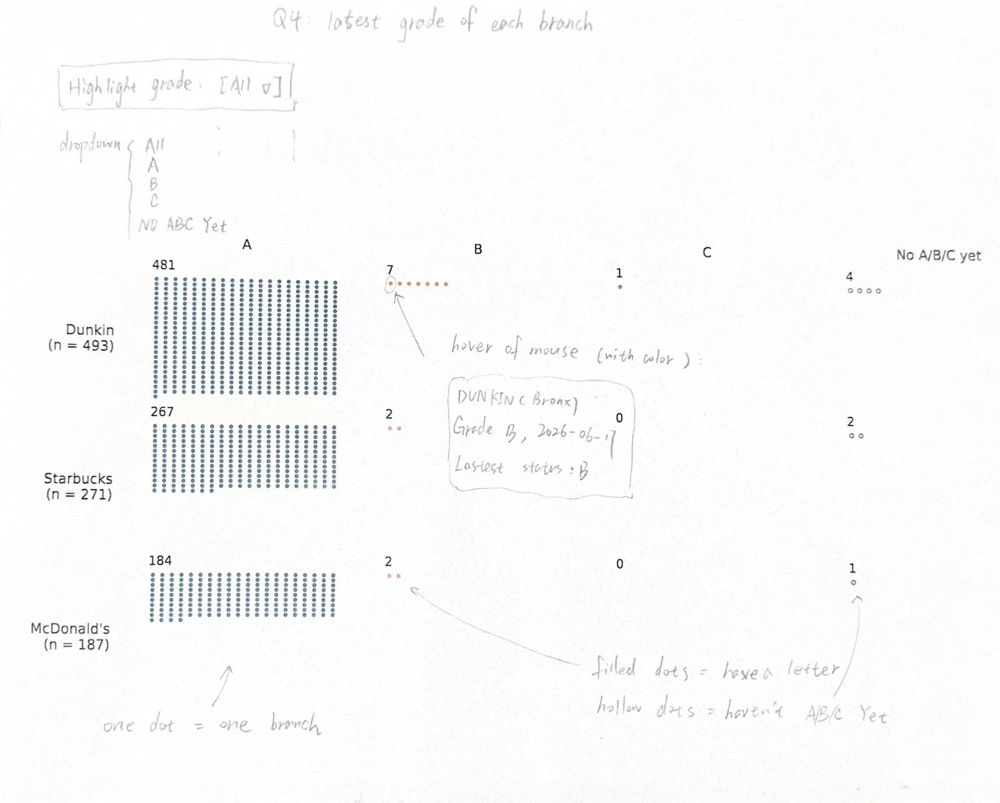
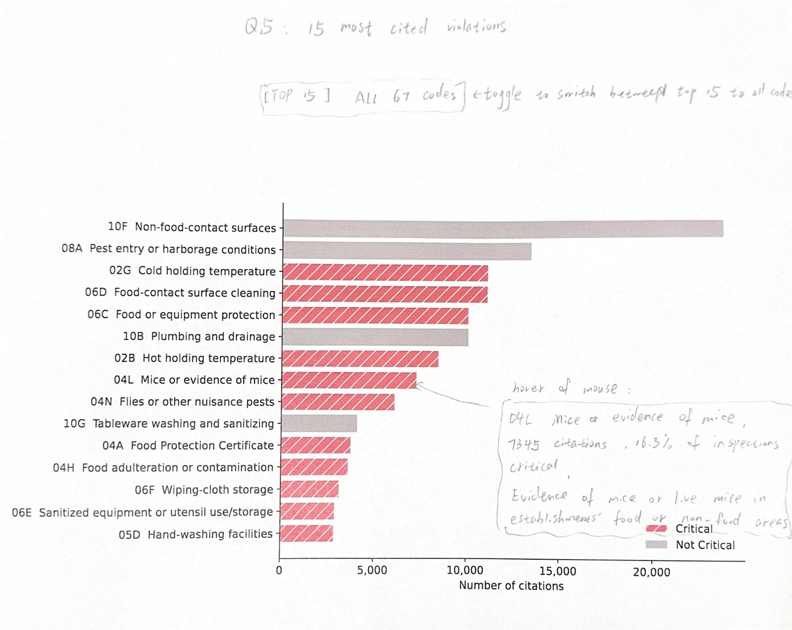
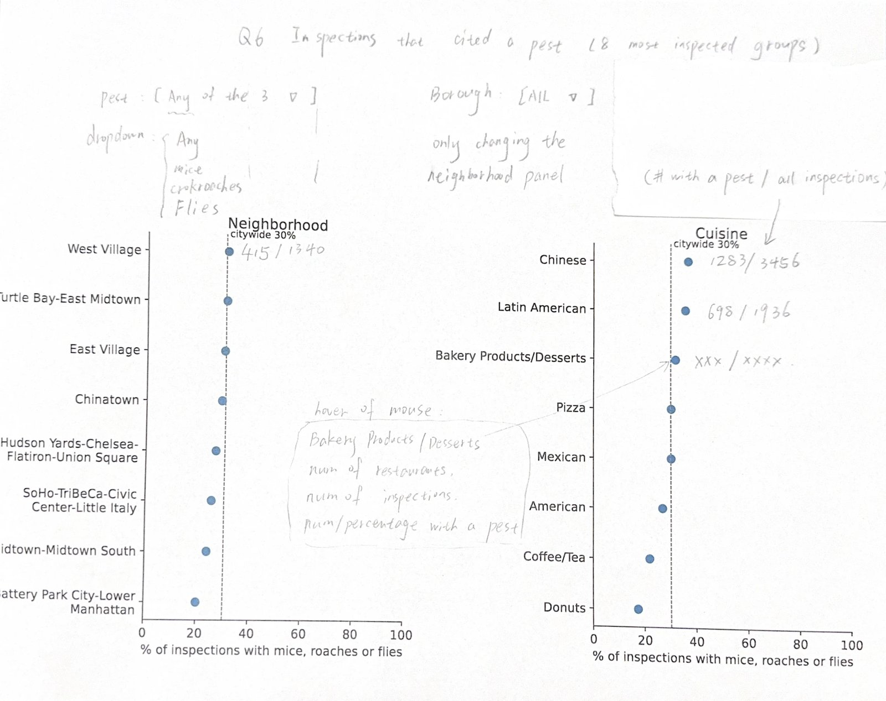

# Milestone 2: Q4-Q6

Team 13: Night's Watch. Q4-Q6 by Yiyang Zhang (yz12500)

## Data

We used the DOHMH NYC Restaurant Inspection Results(https://data.cityofnewyork.us/d/43nn-pn8j)
data. `scripts/clean.py` cuts it into three tables: restaurants
(27,445 rows, one per CAMIS), inspections (92,767 rows) and violations (287,655 rows).
Q4-Q6 all start from these tables.

Q6 also needs neighborhood names. The data only has NTA codes like `MN17`, so we got the
names for 195 NTAs from DCP's
2010 Census Tracts(https://data.cityofnewyork.us/City-Government/2010-Census-Tracts/bmjq-373p) table.

**Inspections used in Q5 and Q6.** We use routine initial inspections
(`Cycle Inspection / Initial Inspection`) from 2023-01-01 to 2026-10-29. That is 45,073 inspections
of 22,066 restaurants. We left out the 1647 older initial inspections. The file only keeps
about three years, so the older years are not complete. Re-inspections and other types are
not used here.

## What changed since the proposal

| Question | Change |
| --- | --- |
| Q4 | Same question. We now define a branch's grade as its latest A, B or C on record. |
| Q5 | The proposal asked which violations "drive scores up". The data only has the total score of each inspection, not the points of each violation. So we count how often each code shows up and how many are critical. |
| Q6 | We look at the share of inspections with mice, cockroaches or flies, by neighborhood and by cuisine. We dropped "which matters more, neighborhood or cuisine". We don't think our data can really answer that. |

## Q4. Do branches of the same chain get similar grades?

**Transformation**

1. Find restaurants with DUNKIN, STARBUCKS or MCDONALD in the name. One CAMIS = one branch.
2. Keep it only if the name starts with the brand and has no other food brand in it. We take out
   124 combo stores like "DUNKIN / BASKIN ROBBINS", because one grade is for both brands. Two names
   just mention a brand, so they are out too: "THE JUICE HOUSE NEAR DUNKIN" and "MCDONALD AVENUE DINER".
3. 12 names were still unclear, so we looked them up one by one (`data/manual/q4-name-decisions.csv`).
   Only the Pace University Starbucks counts. The rest are ferry shops, shared counters, and one
   record with a JFK address but Staten Island as the borough.
4. For each branch, take its latest A, B or C by grade date. If a later inspection has N, Z or P,
   we don't replace the letter. We just keep it as "latest status".
5. Count the grades for each chain. Branches with no A/B/C are counted on their own.

**Processed data: one row per chain** (`/src/data/q4-chain-summary.csv`)

| Chain | Branches | A | B | C | No A/B/C yet | % A (of graded) |
| --- | --- | --- | --- | --- | --- | --- |
| Dunkin | 493 | 481 | 7 | 1 | 4 | 98.4 |
| Starbucks | 271 | 267 | 2 | 0 | 2 | 99.3 |
| McDonald's | 187 | 184 | 2 | 0 | 1 | 98.9 |

**Sample: one row per branch** (`src/data/q4-branches.csv`, 1,088 name matches; 951 are branches)

| CAMIS | Chain | Borough | Grade | Grade date | Latest status |
| --- | --- | --- | --- | --- | --- |
| 40645260 | Dunkin | Queens | A | 2025-10-31 | A |
| 41579661 | Dunkin | Bronx | B | 2026-06-17 | B |
| 41236257 | Dunkin | Brooklyn | C | 2026-06-08 | (blank) |
| 41629686 | Dunkin | Manhattan | - | - | N |
| 40399099 | Starbucks | Manhattan | A | 2026-06-09 | A |
| 40940279 | Starbucks | Manhattan | B | 2026-08-24 | B |
| 50168556 | Starbucks | Manhattan | - | - | (blank) / N |
| 40367790 | McDonald's | Brooklyn | A | 2026-08-12 | A |
| 40881083 | McDonald's | Queens | B | 2026-07-01 | B |
| 50183892 | McDonald's | Manhattan | - | - | N |

**Sketch**



Each chain is a row, each grade is a column, and each dot is one branch. A filled dot has a
letter, a hollow dot has no A/B/C yet. The count is above each group of dots, and n is next to
the chain name. In the D3 version, you can hover a dot to see the branch name, borough, grade
date and latest status.

**Simple analysis from the vision.** All three chains are about 98-99% A. There are only 11 B's and one C in 951
branches, so the grades are really close between branches.

## Q5. Which violations are cited most often, and what share are critical?

**Transformation**

1. Take the violations from the 45,073 inspections above. That is 152,142 rows.
2. 137 rows are exact copies, so we dropped them. 152,005 citations and 67 codes are left.
3. For each code, count the citations and split them by the critical flag on each row. 09A has
   both flags, so we don't put one label on a whole code.
4. % of inspections = inspections with this code / all 45,073 inspections. One inspection can
   have many codes, so the total is more than 100%.

**Overall critical share** (`src/data/q5-critical-summary.csv`)

| Flag | Citations | % |
| --- | --- | --- |
| Critical | 84,839 | 55.8 |
| Not Critical | 67,166 | 44.2 |
| Other / blank | 0 | 0 |

**Sample: one row per code** (`src/data/q5-code-summary.csv`, 67 codes). Top 8 codes, plus 09A
and the rarest one.

| Code | Short name | Citations | Critical | Not Critical | % of inspections |
| --- | --- | --- | --- | --- | --- |
| 10F | Non-food-contact surfaces | 23,797 | 0 | 23,797 | 52.8 |
| 08A | Pest entry or harborage conditions | 13,564 | 0 | 13,564 | 30.1 |
| 02G | Cold holding temperature | 11,231 | 11,231 | 0 | 24.9 |
| 06D | Food-contact surface cleaning | 11,208 | 11,208 | 0 | 24.9 |
| 06C | Food or equipment protection | 10,164 | 10,164 | 0 | 22.6 |
| 10B | Plumbing and drainage | 10,152 | 0 | 10,152 | 22.5 |
| 02B | Hot holding temperature | 8,537 | 8,537 | 0 | 18.9 |
| 04L | Mice or evidence of mice | 7,345 | 7,345 | 0 | 16.3 |
| 09A | Damaged canned food | 522 | 175 | 347 | 1.2 |
| 06H | HACCP records | 1 | 1 | 0 | 0.0 |

**Sketch**



Bars for the top 15 codes, sorted by count, and the x-axis starts at 0. Red with lines is
Critical, gray is Not Critical. If a code has both, its bar is split in two. In the D3 version,
you can hover a bar to see the full description and the % of inspections, and a toggle shows
all 67 codes.

**Simple analysis from the vision.** The most common one is 10F (non-food-contact surfaces). It shows up in more
than half of the inspections, and it is not critical. 6 of the top 10 are critical, like cold
and hot holding temperature and mice.

## Q6. Where do mice, cockroaches and flies show up most?

**Transformation**

1. Use the same 45,073 inspections. 283 of them have no violation, and they stay in.
2. For each inspection, mark if it has 04L (mice), 04M (cockroaches) or 04N (flies and other
   pests). "Any pest" means at least one of them, so mice + roaches in one inspection counts once.
3. Add the NTA names by code. 891 inspections have no NTA, so they go in a "Missing NTA" group.
4. For each NTA and each cuisine: % = inspections with the pest / all inspections in that group.
5. Groups under 30 inspections and the missing group stay in the table, but we don't compare them.

Citywide, about 30% of inspections (13,644 of 45,073) had at least one of the three.

**Sample: one row per NTA** (`src/data/q6-by-nta.csv`, 194 rows). Some big groups, the highest
rates, the missing group and one small group.

| NTA | Name | Inspections | With a pest | % | Compared? |
| --- | --- | --- | --- | --- | --- |
| MN17 | Midtown-Midtown South | 3,035 | 723 | 23.8 | yes |
| MN13 | Hudson Yards-Chelsea-Flatiron-Union Square | 1,404 | 377 | 26.9 | yes |
| MN23 | West Village | 1,340 | 415 | 31.0 | yes |
| MN24 | SoHo-TriBeCa-Civic Center-Little Italy | 1,197 | 305 | 25.5 | yes |
| MN27 | Chinatown | 915 | 265 | 29.0 | yes |
| QN52 | East Flushing | 66 | 36 | 54.5 | yes |
| BK91 | East Flatbush-Farragut | 121 | 62 | 51.2 | yes |
| QN03 | Springfield Gardens South-Brookville | 53 | 25 | 47.2 | yes |
| - | Missing NTA | 891 | 201 | 22.6 | no |
| BK46 | Ocean Parkway South | 29 | 8 | 27.6 | no (< 30) |

**Sample: one row per cuisine** (`src/data/q6-by-cuisine.csv`, 89 rows)

| Cuisine | Inspections | With a pest | % | Compared? |
| --- | --- | --- | --- | --- |
| American | 7,886 | 2,130 | 27.0 | yes |
| Coffee/Tea | 4,067 | 895 | 22.0 | yes |
| Chinese | 3,456 | 1,283 | 37.1 | yes |
| Pizza | 2,763 | 842 | 30.5 | yes |
| Latin American | 1,936 | 698 | 36.1 | yes |
| Pakistani | 57 | 31 | 54.4 | yes |
| African | 127 | 66 | 52.0 | yes |
| German | 49 | 25 | 51.0 | yes |
| Ethiopian | 22 | 11 | 50.0 | no (< 30) |

**Sketch**



Two dot plots, neighborhoods on the left and cuisines on the right, on the same 0-100% axis.
The dashed line is the citywide rate. This draft only shows the 8 most inspected groups, and for
NTAs they are all in Manhattan. The D3 version will show more groups, with a borough filter and
a switch for mice / cockroaches / flies / any. Each dot will have its count next to it (with a
pest / all inspections), and you can hover it to see how many restaurants and inspections.

**Simple analysis from the vision.** In the big groups, Chinese and Latin American places are higher (36-37%), and
Coffee/Tea and Donuts are lower (18-22%). The busy Manhattan neighborhoods are around or below
the citywide rate. The highest rates are in small groups (50-55%), so we show the counts too.
We only see what was cited, so these rates describes inspections,
but not every restaurant in a group.

## How to run

From the repo root dicretory, after `scripts/download.py` and `scripts/clean.py`:

```bash
python3 scripts/download-nta-lookup.py
python3 scripts/question-specific/question-4.py
python3 scripts/question-specific/question-5.py
python3 scripts/question-specific/question-6.py
python3 scripts/question-specific/plot-q4-q6.py   # base charts for the sketches, saved outside the repo
```

## References

- NYC restaurant business guide(https://nyc-business.nyc.gov/nycbusiness/resources-by-industry/restaurant) (violation codes)
- NYC inspection scoring rules(https://codelibrary.amlegal.com/codes/newyorkcity/latest/NYCrules/0-0-0-136924)
- DCP 2010 Census Tracts(https://data.cityofnewyork.us/City-Government/2010-Census-Tracts/bmjq-373p)
