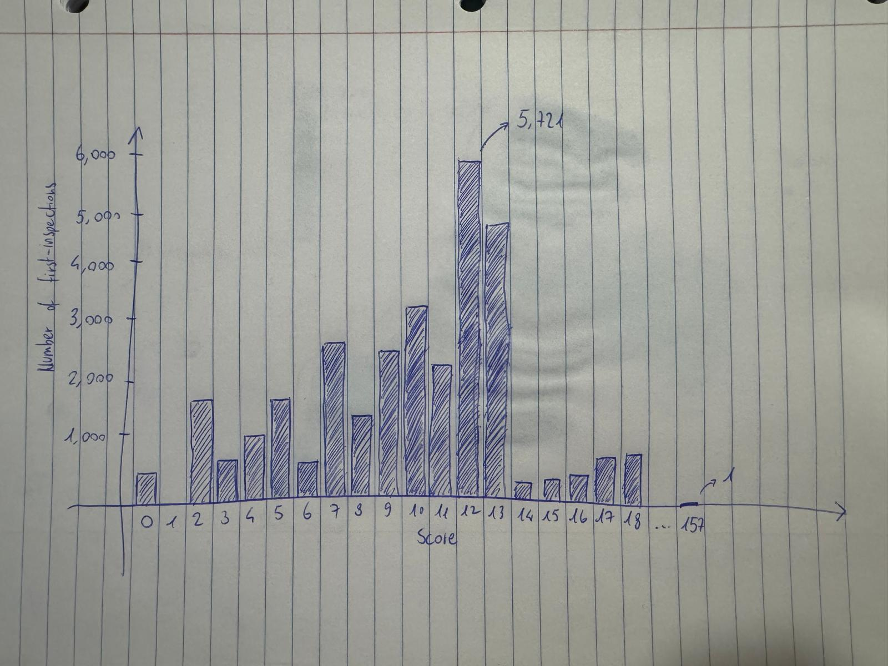

# How does a restaurant earn its A, and how are first-inspection scores distributed?

Every violation adds points, and a score of 0 to 13 earns an A. This page shows how scores are spread out at first inspections, the routine unannounced visit that starts each inspection cycle, with the A cutoff marked.

## Data Transformation

**Goal:** Get an array of scores, each with their number of matching inspections.

1. Get `inspections` table, which has one row per inspection. The raw file has one row per violation and repeats the score on each of them, so counting raw rows would count an inspection once for every violation. Keep only first inspections by matching the `inspection_type` to "Cycle Inspection / Initial Inspection"
2. Keep only first inspections from ${q1.start} to ${q1.end}, the same window as Q5 and Q6. The file keeps about three years, so the ${d3.format(",")(q1.older_left_out)} older first inspections are leftovers rather than a fair sample of their years
3. Group inspections by attribute `score` to get the count for each score
4. Fill in any score that has no inspection associated, this is important because many scores have no count and cause the charts to skip their bars. (e.g. Score 1 has 0 matches)
5. Save the numbers quoted on this page (window, snapshot, counts at 12, 13 and 14) to `q1-summary.json`, so the text updates with the data

**Changes since earlier milestones:** the proposal reported 215 first inspections at 14. Milestone 2 counted one row per inspection over all years and found 4,784 at 13 and 210 at 14. Limiting the inspections to the window above gives ${d3.format(",")(q1.count_13)} at 13 and ${d3.format(",")(q1.count_14)} at 14 in the ${q1.snapshot.match(/\d{4}-\d{2}-\d{2}/)[0]} snapshot.

```js
const scores = FileAttachment("/data/q1-scores.csv").csv({typed: true});
const q1 = FileAttachment("/data/q1-summary.json").json();
```

## Inspections by Score

```js
display(Inputs.table(scores, {
  layout: "auto",
  header: {score: "Score", count: "First inspections"}
}))
```

## Chart Sketch
A bar chart with x-axis representing the scores from 0 to 157 (apparently one restaurant has a score of 157) and a y-axis representing the number of inspections matching the scores. A dashed line between 13 and 14 marks the A cutoff. Hovering a bar shows the count.



<div class="note">
    <ul>
        <li>Why no restaurant has score equal to 1? Because each violation adds a certain score, and even the "lowest" violation is not worth 1.</li>
        <li>Why do so many first inspections score 13 and so few score 14? 13 is the highest score that still gets an A. With 14 or more, the restaurant does not get an A on that visit and has to be inspected again. The data show the drop but not its cause. Others have pointed to:
            <ul>
                <li>Room for judgment: each violation has a minimum number of points, and the inspector adds more depending on how serious it is (<a href="https://www.nyc.gov/assets/doh/downloads/pdf/rii/restaurant-grading-faq.pdf">NYC Health</a>).</li>
                <li>Inspectors going easy on the last violation that would push a restaurant past 13 (<a href="https://www.barfblog.com/2014/02/are-nyc-health-inspectors-inflating-restaurant-grades/">Wellington, 2014</a>).</li>
                <li>Inspectors adjusting scores near grade cutoffs in Los Angeles (<a href="https://econpapers.repec.org/RePEc:eee:jeborg:v:172:y:2020:i:c:p:292-313">Makofske, 2020</a>).</li>
            </ul>
            None of these prove that this is why the drop happens in New York.
        </li>
    </ul>
</div>

## D3 Chart (made by me)

```js
display(scoreHistogram(scores, {width}));
```

```js
function scoreHistogram(data, {width}) {
    const margin = 60;

    const dims = {
        width: width,
        height: 500
    };

    const innerDims = {
        width: dims.width - 2 * margin,
        height: dims.height - 2 * margin
    };

    const chartSvg = d3.create("svg")
        .attr("width", dims.width)
        .attr("height", dims.height);

    const chart = chartSvg.append("g")
        .attr("transform", `translate(${margin}, ${margin})`)
        .attr("width", innerDims.width)
        .attr("height", innerDims.height);

    const x = d3.scaleBand()
        .domain(data.map(d => d.score))
        .range([0, innerDims.width]);

    const y = d3.scaleLinear()
        .domain([0, d3.max(data, d => d.count)])
        .range([innerDims.height, 0]);

    const bars = chart.selectAll("rect")
        .data(data)
        .join("rect")
        .attr("x", d => x(d.score))
        .attr("y", d => y(d.count))
        .attr("width", x.bandwidth())
        .attr("height", d => innerDims.height - y(d.count))
        .attr("fill", "var(--color-accent)");

    bars.append("title")
        .text(d => "Score " + d.score + ": " + d3.format(",")(d.count) + " First-Inspections");

    chart.append("g")
        .attr("transform", `translate(${0}, ${innerDims.height})`)
        .call(d3.axisBottom(x));

    chart.append("g")
        .call(d3.axisLeft(y));

    chart.append("text")
        .attr("x", innerDims.width / 2)
        .attr("y", innerDims.height + margin - 20)
        .attr("font-weight", "bold")
        .attr("text-anchor", "middle")
        .text("Score");

    chart.append("text")
        .attr("transform", "rotate(-90)")
        .attr("x", -innerDims.height / 2)
        .attr("y", -45)
        .attr("font-weight", "bold")
        .attr("text-anchor", "middle")
        .text("Number of First-Inspections");
    
    chart.append("text")
        .attr("x", innerDims.width / 2)
        .attr("y", -20)
        .attr("font-weight", "bold")
        .attr("text-anchor", "middle")
        .text("Distribution of First-Inspection Scores (" + q1.start.slice(0, 4) + " - " + q1.end.slice(0, 4) + ")");

    return chartSvg.node();
}
```

## D3 Chart (made by Claude)
```js
display(scoreHistogramBrush(scores, {width}));
```

<p class="q1-caption">Routine first inspections (Cycle Inspection / Initial Inspection) from ${q1.start} to ${q1.end}, n = ${d3.format(",")(q1.inspections)}, from the ${q1.snapshot.match(/\d{4}-\d{2}-\d{2}/)[0]} snapshot. The city's file keeps about three years of inspections, so 2023 is only partly covered.</p>

- The top chart shows one bar per score. It starts at 0 to 50, so the cutoff is easy to see.
- The strip below shows every score up to ${q1.max_score}. Drag across it to choose which scores the top chart shows, or drag the gray box to move along. The y-axis of the top chart adjusts to the scores shown, so the high scores stay readable.
- The buttons jump back to the cutoff view or to all scores.
- Hover a bar to see its count and its share of all first inspections.

```js
// Histogram of scores with an overview strip: brushing the strip picks the scores shown above
function scoreHistogramBrush(data, {width}) {
    const margin = 60;
    const cutoff = 13;
    const initialRange = [0, 50];

    const dims = {
        width: width,
        height: 500
    };

    const innerDims = {
        width: dims.width - 2 * margin,
        height: dims.height - 2 * margin
    };

    const overviewDims = {
        height: 50
    };

    const format = d3.format(",");
    const percent = d3.format(".1%");
    const total = d3.sum(data, d => d.count);
    const maxScore = d3.max(data, d => d.score);
    const countOf = new Map(data.map(d => [d.score, d.count]));
    const isA = d => d.score <= cutoff;

    const container = d3.create("div")
        .attr("class", "q1-chart");

    // Legend and view buttons above the chart
    const controls = container.append("div")
        .attr("class", "q1-controls");

    const legend = controls.append("div")
        .attr("class", "q1-legend");

    for (const [className, label] of [["q1-a", "0-13: A on the spot"], ["q1-no-a", "14 or more: no A at this visit"]]) {
        const item = legend.append("span");

        item.append("span")
            .attr("class", "q1-swatch " + className);

        item.append("span")
            .text(label);
    }

    const buttons = controls.append("div")
        .attr("class", "q1-buttons");

    // Main chart
    const chartSvg = container.append("svg")
        .attr("width", dims.width)
        .attr("height", dims.height);

    const chart = chartSvg.append("g")
        .attr("transform", `translate(${margin}, ${margin})`);

    const tooltip = container.append("div")
        .attr("class", "q1-tooltip")
        .style("opacity", 0);

    const x = d3.scaleBand()
        .range([0, innerDims.width]);

    const y = d3.scaleLinear()
        .range([innerDims.height, 0]);

    const gridGroup = chart.append("g")
        .attr("class", "q1-grid");

    const barsGroup = chart.append("g");

    const cutoffGroup = chart.append("g")
        .attr("class", "q1-cutoff");

    const hoverGroup = chart.append("g");

    const xAxisGroup = chart.append("g")
        .attr("transform", `translate(0, ${innerDims.height})`);

    const yAxisGroup = chart.append("g");

    chart.append("text")
        .attr("x", innerDims.width / 2)
        .attr("y", innerDims.height + margin - 20)
        .attr("font-weight", "bold")
        .attr("text-anchor", "middle")
        .text("Score");

    chart.append("text")
        .attr("transform", "rotate(-90)")
        .attr("x", -innerDims.height / 2)
        .attr("y", -45)
        .attr("font-weight", "bold")
        .attr("text-anchor", "middle")
        .text("Number of First-Inspections");

    chart.append("text")
        .attr("x", innerDims.width / 2)
        .attr("y", -20)
        .attr("font-weight", "bold")
        .attr("text-anchor", "middle")
        .text("Distribution of First-Inspection Scores (" + q1.start.slice(0, 4) + " - " + q1.end.slice(0, 4) + ")");

    // Bars: at most 24px wide, 2px gap, 4px rounded top, square at the baseline
    function barPath(d) {
        if (d.count === 0) return "";

        const barWidth = Math.min(24, Math.max(1, x.step() - 2));
        const left = x(d.score) + (x.step() - barWidth) / 2;
        const bottom = y(0);
        const top = y(d.count);
        const radius = Math.min(4, barWidth / 2, bottom - top);

        return "M" + left + "," + bottom
            + "V" + (top + radius)
            + "Q" + left + "," + top + " " + (left + radius) + "," + top
            + "H" + (left + barWidth - radius)
            + "Q" + (left + barWidth) + "," + top + " " + (left + barWidth) + "," + (top + radius)
            + "V" + bottom + "Z";
    }

    function showTooltip(event, d) {
        const [pointerX, pointerY] = d3.pointer(event, container.node());

        tooltip
            .style("opacity", 1)
            .style("left", Math.min(pointerX + 14, dims.width - 230) + "px")
            .style("top", Math.max(0, pointerY - 70) + "px")
            .html("<strong>Score " + d.score + "</strong><br>"
                + format(d.count) + " first inspections (" + percent(d.count / total) + ")<br>"
                + (isA(d) ? "A on the spot" : "No A at this visit, a re-inspection follows"));
    }

    function hideTooltip() {
        tooltip.style("opacity", 0);
        barsGroup.selectAll("path").classed("q1-faded", false);
    }

    function update([low, high]) {
        const shown = data.filter(d => d.score >= low && d.score <= high);

        x.domain(shown.map(d => d.score));

        y.domain([0, d3.max(shown, d => d.count) || 1])
            .nice();

        // Tick every 1, 2, 5, 10... scores, whichever keeps the labels apart
        const tickStep = [1, 2, 5, 10, 20, 25, 50].find(step => step * x.step() >= 28) ?? 50;

        xAxisGroup.call(d3.axisBottom(x)
            .tickValues(shown.map(d => d.score).filter(score => score % tickStep === 0))
            .tickSizeOuter(0));

        yAxisGroup.call(d3.axisLeft(y)
            .ticks(5)
            .tickFormat(format)
            .tickSize(0)
            .tickPadding(8));

        yAxisGroup.select(".domain").remove();

        gridGroup.selectAll("line")
            .data(y.ticks(5))
            .join("line")
            .attr("x1", 0)
            .attr("x2", innerDims.width)
            .attr("y1", d => y(d))
            .attr("y2", d => y(d));

        barsGroup.selectAll("path")
            .data(shown, d => d.score)
            .join("path")
            .attr("class", d => isA(d) ? "q1-a" : "q1-no-a")
            .attr("d", barPath);

        // Hover targets cover the whole column, so short and empty bars are easy to hit.
        // Named listeners (.fade, .tip), so the second pointerenter doesn't replace the first
        hoverGroup.selectAll("rect")
            .data(shown, d => d.score)
            .join("rect")
            .attr("x", d => x(d.score))
            .attr("y", 0)
            .attr("width", x.step())
            .attr("height", innerDims.height)
            .attr("fill", "transparent")
            .on("pointerenter.fade", (event, d) => barsGroup.selectAll("path").classed("q1-faded", bar => bar.score !== d.score))
            .on("pointerenter.tip pointermove.tip", showTooltip)
            .on("pointerleave", hideTooltip);

        // Cutoff line between 13 and 14, with the two counts it separates
        const cutoffShown = low <= cutoff && high >= cutoff + 1;
        const cutoffX = cutoffShown ? x(cutoff + 1) : 0;
        const compact = innerDims.width < 400;  // phones: shorter labels so they fit
        const textOnLeft = cutoffX > innerDims.width - (compact ? 80 : 190);
        const cutoffLabels = [
            "A cutoff",
            (compact ? "" : "Score ") + cutoff + ": " + format(countOf.get(cutoff)) + (compact ? "" : " first inspections"),
            (compact ? "" : "Score ") + (cutoff + 1) + ": " + format(countOf.get(cutoff + 1))
        ];

        cutoffGroup.selectAll("line")
            .data(cutoffShown ? [cutoffX] : [])
            .join("line")
            .attr("x1", d => d)
            .attr("x2", d => d)
            .attr("y1", 0)
            .attr("y2", innerDims.height);

        cutoffGroup.selectAll("text")
            .data(cutoffShown ? cutoffLabels : [])
            .join("text")
            .attr("x", textOnLeft ? cutoffX - 6 : cutoffX + 6)
            .attr("y", (d, i) => 12 + i * 15)
            .attr("text-anchor", textOnLeft ? "end" : "start")
            .attr("font-weight", (d, i) => i === 0 ? "bold" : "normal")
            .text(d => d);
    }

    // Overview strip with every score, and a brush that picks the scores shown above
    const overviewSvg = container.append("svg")
        .attr("width", dims.width)
        .attr("height", overviewDims.height + 30);

    const overview = overviewSvg.append("g")
        .attr("transform", `translate(${margin}, 4)`);

    const overviewX = d3.scaleLinear()
        .domain([0, maxScore + 1])
        .range([0, innerDims.width]);

    const overviewY = d3.scaleLinear()
        .domain([0, d3.max(data, d => d.count)])
        .range([overviewDims.height, 0]);

    overview.selectAll("rect")
        .data(data.filter(d => d.count > 0))
        .join("rect")
        .attr("class", d => isA(d) ? "q1-a" : "q1-no-a")
        .attr("x", d => overviewX(d.score))
        .attr("y", d => overviewY(d.count))
        .attr("width", Math.max(0.5, overviewX(1) - overviewX(0) - 0.5))
        .attr("height", d => overviewDims.height - overviewY(d.count));

    overview.append("g")
        .attr("transform", `translate(0, ${overviewDims.height})`)
        .call(d3.axisBottom(overviewX)
            .ticks(Math.max(4, width / 90))
            .tickSizeOuter(0));

    overview.append("text")
        .attr("x", -8)
        .attr("y", overviewDims.height / 2 + 4)
        .attr("font-weight", "bold")
        .attr("text-anchor", "end")
        .text("All");

    // Turn a brush selection into whole scores, at least 10 of them
    function toScores([left, right]) {
        let low = Math.max(0, Math.round(overviewX.invert(left)));
        let high = Math.min(maxScore, Math.round(overviewX.invert(right)) - 1);

        if (high - low < 9) {
            high = Math.min(maxScore, low + 9);
            low = Math.max(0, high - 9);
        }

        return [low, high];
    }

    function toPixels([low, high]) {
        return [overviewX(low), overviewX(high + 1)];
    }

    const brush = d3.brushX()
        .extent([[0, 0], [innerDims.width, overviewDims.height]])
        .on("brush end", ({selection, sourceEvent, type}) => {
            // A click without a drag shows every score
            if (!selection) {
                brushGroup.call(brush.move, toPixels([0, maxScore]));
                return;
            }

            const range = toScores(selection);
            update(range);

            // Snap the brush to whole scores when the drag ends
            if (type === "end" && sourceEvent) {
                brushGroup.call(brush.move, toPixels(range));
            }
        });

    const brushGroup = overview.append("g")
        .call(brush);

    for (const [label, range] of [["Around the cutoff (0-50)", initialRange], ["All scores (0-" + maxScore + ")", [0, maxScore]]]) {
        buttons.append("button")
            .attr("type", "button")
            .text(label)
            .on("click", () => brushGroup.transition().duration(400).call(brush.move, toPixels(range)));
    }

    brushGroup.call(brush.move, toPixels(initialRange));

    return container.node();
}
```

<style>
.q1-chart {
  position: relative;
  font: 12px var(--sans-serif);
  max-width: 100%;
}
.q1-chart svg {
  display: block;
  max-width: 100%;
  overflow: visible;
}
.q1-controls {
  display: flex;
  flex-wrap: wrap;
  justify-content: space-between;
  align-items: center;
  gap: 8px 16px;
  margin-bottom: 8px;
}
.q1-legend {
  display: flex;
  flex-wrap: wrap;
  gap: 4px 16px;
  color: var(--theme-foreground);
}
.q1-swatch {
  display: inline-block;
  width: 10px;
  height: 10px;
  border-radius: 2px;
  margin-right: 6px;
  vertical-align: -1px;
}
.q1-buttons {
  display: flex;
  gap: 6px;
}
.q1-chart .q1-a {
  fill: var(--color-accent);
  background: var(--color-accent);
}
.q1-chart .q1-no-a {
  fill: #eb6834;
  background: #eb6834;
}
.q1-chart path.q1-faded {
  fill: var(--theme-foreground-faint);
}
.q1-grid line {
  stroke: var(--theme-foreground-faintest);
}
.q1-cutoff line {
  stroke: var(--theme-foreground);
  stroke-width: 1.5;
  stroke-dasharray: 4 3;
}
.q1-cutoff text {
  fill: var(--theme-foreground);
}
.q1-axis-title {
  fill: var(--theme-foreground-muted);
}
.q1-tooltip {
  position: absolute;
  pointer-events: none;
  max-width: 220px;
  padding: 6px 8px;
  border: 1px solid var(--theme-foreground-faint);
  border-radius: 4px;
  background: var(--theme-background);
  color: var(--theme-foreground);
  box-shadow: 0 2px 6px rgba(0, 0, 0, 0.12);
  transition: opacity 0.1s;
}
.q1-caption {
  color: var(--theme-foreground-muted);
  font-size: 13px;
}
</style>
