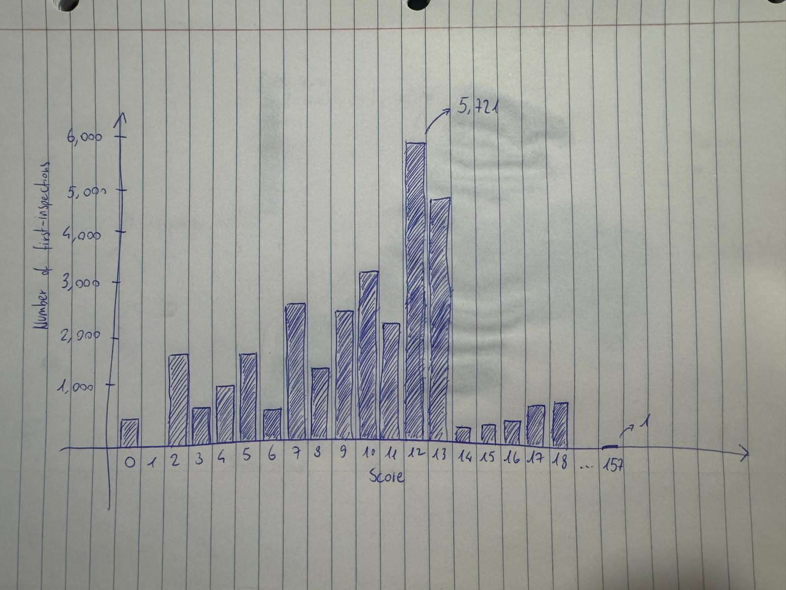

# How does a restaurant earn its A, and how are first-inspection scores distributed?

Every violation adds points, and a score of 0 to 13 earns an A. This page shows how scores are spread out at first inspections, the routine unannounced visit that starts each inspection cycle, with the A cutoff marked.

## Data Transformation

**Goal:** Get an array of scores, each with their number of matching inspections.

1. Get `inspections` table, which has one row per inspection. The raw file has one row per violation and repeats the score on each of them, so counting raw rows would count an inspection once for every violation. Keep only first inspections by matching the `inspection_type` to "Cycle Inspection / Initial Inspection"
2. Group inspections by attribute `score` to get the count for each score
3. Fill in any score that has no inspection associated, this is important because many scores have no count and cause the charts to skip their bars. (e.g. Score 1 has 0 matches)

```js
const scores = FileAttachment("/data/q1-scores.csv").csv({typed: true});
```

## Inspections by Score

```js
display(Inputs.table(scores, {layout: "auto"}))
```

## Chart Sketch
A bar chart with x-axis representing the scores from 0 to 157 (apparently one restaurant has a score of 157) and a y-axis representing the number of inspections matching the scores. A dashed line between 13 and 14 marks the A cutoff. Hovering a bar shows the count.



<div class="note">
    <ul>
        <li>Why no restaurant has score equal to 1? Because each violation adds a certain score, and even the "lowest" violation is not worth 1.</li>
        <li>Why do so many first inspections score 13 and so few score 14? 13 is the highest score that still gets an A. With 14 or more, the restaurant does not get an A on that visit and has to be inspected again. The data show the drop but not its cause. Others have pointed to:
            <ul>
                <li>Room for judgment: each violation has a minimum number of points, and the inspector adds more depending on how serious it is (<a href="https://www.nyc.gov/assets/doh/downloads/pdf/rii/restaurant-grading-faq.pdf">NYC Health</a>).</li>
                <li>Inspectors going easy on the last violation that would push a restaurant past 13 (<a href="https://www.barfblog.com/2014/02/are-nyc-health-inspectors-inflating-restaurant-grades/">Wellington, 2014</a>).</li>
                <li>Inspectors adjusting scores near grade cutoffs in Los Angeles (<a href="https://econpapers.repec.org/RePEc:eee:jeborg:v:172:y:2020:i:c:p:292-313">Makofske, 2020</a>).</li>
            </ul>
            None of these prove that this is why the drop happens in New York.
        </li>
    </ul>
</div>
