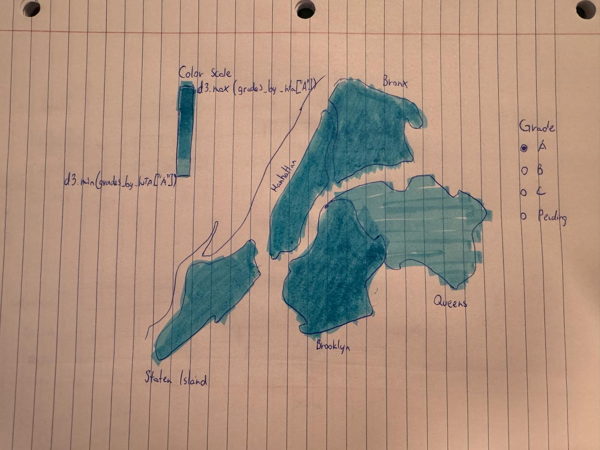

# How much does the share of A grades vary by borough and neighborhood?

A map of New York showing the share of restaurants with an A in each neighborhood. Zoom in from boroughs to neighborhoods to see where an A is more or less common.

## Data Transformation

**Goal:** For every borough and NTA (Neighborhood Tabulation Area), count how many restaurants have each grade, using each restaurant's most recent grade. According to the city's [How We Score and Grade](https://www.nyc.gov/assets/doh/downloads/pdf/rii/restaurant-grading-faq.pdf) guide:

- A first inspection with 0 to 13 points gives an A. With 14 or more there is no grade yet, and a re-inspection decides A, B or C.
- A restaurant that gets a B or C can post "Grade Pending" until its hearing.

Besides A, B and C, the data also has N (not yet graded), Z (grade pending) and P (grade pending after reopening). None of these are letter grades, so we name them after the card the restaurant posts in its window: N is "Not Yet Graded", and Z and P are both "Grade Pending". Q7 uses the same card names.

<div class="tip">
  <strong>Grade definition (same as Q4):</strong> a restaurant's grade is the grade of its most recent graded inspection, which is the card it posts now. A later Grade Pending or Not Yet Graded replaces an earlier A, B or C. Restaurants that were never graded are left out.
</div>

1. Get the `inspections` table, remove rows with no grade and sort by `inspection_date`. Many inspections have no grade because they are not graded at all, for example a first inspection with 14 or more points or an administrative inspection. Removing them only leaves a restaurant out if it has never had a graded inspection
2. Group by `camis` and keep the last graded inspection, so there is one row per restaurant. This step is shared with Q4 (`current_grades` in `scripts/question-specific/common.py`)
3. Turn N into "Not Yet Graded", and Z and P into "Grade Pending"
4. Join with the `restaurants` table on `camis` to get each restaurant's `nta`. Restaurants without an NTA can't be placed on the map, so they are left out of both tables
5. Get the borough from the first two letters of the NTA code (MN, BX, BK, QN, SI) instead of the `boro` column. The two only disagree for a few restaurants in Marble Hill, which is in Manhattan but has Bronx addresses
6. Count the restaurants per NTA for each grade card (`count_A`, `count_B`, `count_C`, `count_grade_pending`, `count_not_graded`, `total_count`). The borough table is the sum of its NTAs, so the borough totals match the map. The CSVs only store counts and the shares are calculated on the page
7. Add every 2010 NTA with its name (`nta_name`, from DCP's 2010 Census Tracts table), so each shape on the map has a row. NTAs without restaurants get zeros
8. Mark the NTAs that are gray on the map in `gray_reason`: parks, cemeteries and the airports (JFK and LaGuardia), whose restaurants are concessions and food courts rather than a neighborhood, and NTAs with fewer than ${q2.min_restaurants} restaurants, whose shares would be based on too few restaurants to compare
9. Save who is on the map and who is left out to `q2-summary.json`, so the counts below update with the data

**Map boundaries:** the inspection data uses 2010 NTA codes, so the map uses 2010 NTAs too. NYC Open Data no longer has the 2010 NTA boundary file, so we build it from DCP's [2010 Census Tracts](https://data.cityofnewyork.us/City-Government/2010-Census-Tracts/bmjq-373p) table, the same table the NTA names come from. 2010 NTAs are made of whole tracts, so merging the tracts by NTA code gives the NTA shapes. The outlines are simplified to keep the file small (`scripts/download-nta-boundaries.py`, output `nta-2010.json`).

**Who is on the map:** ${format(q2.with_grade)} restaurants have a grade in the ${q2.snapshot.match(/\d{4}-\d{2}-\d{2}/)[0]} snapshot. ${format(q2.no_nta)} have no NTA and are left out, so the map and both tables count **${format(q2.on_map)} restaurants**. ${q2.ntas_colored} of the ${q2.ntas} NTAs are colored. The other ${q2.ntas_gray_park + q2.ntas_gray_airport + q2.ntas_gray_too_few} are gray (${q2.ntas_gray_park} parks and cemeteries, ${q2.ntas_gray_airport} airport, ${q2.ntas_gray_too_few} with fewer than ${q2.min_restaurants} restaurants) and hold ${format(q2.restaurants_in_gray_ntas)} restaurants, which still count in their borough.

```js
const boroughs = FileAttachment("/data/q2-boro.csv").csv({typed: true});
const nta = FileAttachment("/data/q2-nta.csv").csv({typed: true});
const q2 = FileAttachment("/data/q2-summary.json").json();
const format = d3.format(",");

// Readable column names for the tables below
const header = {
  nta: "NTA",
  nta_name: "Name",
  gray_reason: "Gray on the map because",
  boro: "Borough",
  count_A: "A",
  count_B: "B",
  count_C: "C",
  count_grade_pending: "Grade Pending",
  count_not_graded: "Not Yet Graded",
  total_count: "Total"
};
```

## Grades by Borough

```js
display(Inputs.table(boroughs, {layout: "auto", header}))
```

## Grades by NTA

```js
display(Inputs.table(nta, {layout: "auto", header}))
```

## Chart Sketch
A map of New York where each area is colored by the share of its restaurants that have the selected grade. Darker means a higher share. The radio buttons on the right pick the grade (A, B, C or Pending), and the color scale on the left shows which share each color stands for. The map starts with the boroughs and you can zoom in to see the neighborhoods (NTAs). Parks, cemeteries and NTAs with fewer than 20 restaurants are gray, because their share would be based on too few restaurants to compare.



<div class="note">
    <ul>
        <li>The boroughs color-wise look pretty similar because their A-share are close. Lowest is Queens with 75.5% and highest is Manhattan and Bronx with 80.1%.</li>
        <li>Why does each grade have its own color scale? Because the shares are very different. Most restaurants have an A, and only a few have a B or a C. On the A scale, every area would look the same color for B and C.</li>
        <li>The city's inspection data only includes restaurants that are still open. Restaurants that closed are removed together with their grades, so they are not on the map.</li>
        <li>Grade Pending and Not Yet Graded are not the same as "unknown", and they are not the same as each other. Not Yet Graded is given at a first inspection, mostly to new restaurants that scored 14 or more and wait for their re-inspection. Grade Pending is given at a re-inspection or a reopening; most of these restaurants scored 14 or more and are contesting their B or C at a hearing.</li>
        <li>Why do the boroughs and the neighborhoods use the same scale? So a color always means the same share. If the borough view had its own scale, small differences between boroughs would look big and the colors would change when you zoom in.</li>
    </ul>
</div>

## D3 Chart (made by Claude)

```js
const ntaShapes = FileAttachment("/data/nta-2010.json").json();

// Remembers the zoomed-in borough, so switching the grade keeps the current view
const mapState = {borough: null};
```

```js
const grade = view(Inputs.radio(["A", "B", "C", "Grade Pending", "Not Yet Graded"], {label: "Share of restaurants with", value: "A"}));
```

```js
display(gradeMap(ntaShapes, nta, boroughs, {width, grade, minRestaurants: q2.min_restaurants}));
```

<p class="q2-caption">${format(q2.on_map)} restaurants with an NTA, each counted by its most recent graded inspection (the grade definition above), from the ${q2.snapshot.match(/\d{4}-\d{2}-\d{2}/)[0]} snapshot. ${format(q2.no_nta)} restaurants without an NTA are not on the map.</p>

- The radio buttons pick the grade. Darker means a higher share of restaurants with that grade.
- Each grade has its own color scale, from its lowest to its highest NTA share, and the legend shows the numbers. The boroughs and the neighborhoods use the same scale, so a color means the same share at every zoom level.
- Click a borough to zoom in to its neighborhoods (NTAs), and click another borough to move there. Click the button or the water to go back to all boroughs.
- Hover an area to see its share and counts. Gray areas are parks, cemeteries and the airports, or NTAs with fewer than ${q2.min_restaurants} restaurants.

<div class="warning" label="AI Disclosure">
  I asked Claude to make this map. Claude wrote its code (the borough zoom, the color scales and legend, the tooltip and the grade buttons). Claude also built the 2010 NTA boundary file and the gray-area and summary columns in the data processing.
</div>

```js
// Choropleth of the share of restaurants with the selected grade: boroughs first, click to zoom in to NTAs
function gradeMap(topology, ntaRows, boroughRows, {width, grade, minRestaurants}) {
    const columnOf = {
        "A": "count_A",
        "B": "count_B",
        "C": "count_C",
        "Grade Pending": "count_grade_pending",
        "Not Yet Graded": "count_not_graded"
    };

    // One hue per grade, light (low share) to dark (high share)
    const colorsOf = {
        "A": d3.interpolateBlues,
        "B": d3.interpolateOranges,
        "C": d3.interpolateReds,
        "Grade Pending": d3.interpolatePurples,
        "Not Yet Graded": d3.interpolateGreens
    };

    const column = columnOf[grade];
    const format = d3.format(",");
    const percent = d3.format(".1%");
    const shareOf = row => row.total_count ? row[column] / row.total_count : 0;
    const isColored = row => !row.gray_reason;

    const rowOfNta = new Map(ntaRows.map(row => [row.nta, row]));
    const rowOfBorough = new Map(boroughRows.map(row => [row.boro, row]));

    // NTA shapes, and borough shapes made by merging the NTAs of each borough
    const ntaFeatures = topojson.feature(topology, topology.objects.ntas).features
        .map(feature => ({...feature, row: rowOfNta.get(feature.properties.nta)}));

    const boroughFeatures = boroughRows.map(row => ({
        type: "Feature",
        row: row,
        geometry: topojson.merge(topology, topology.objects.ntas.geometries
            .filter(geometry => rowOfNta.get(geometry.properties.nta).boro === row.boro))
    }));

    // Fixed scale for the selected grade, shared by the borough and NTA views:
    // from the lowest to the highest share among the colored NTAs
    const color = d3.scaleSequential()
        .domain(d3.extent(ntaRows.filter(isColored), shareOf))
        .interpolator(t => colorsOf[grade](0.1 + 0.9 * t))
        .clamp(true);

    const dims = {
        width: width,
        height: Math.min(640, Math.round(width * 0.95))
    };

    const container = d3.create("div")
        .attr("class", "q2-map");

    // Legend, gray key and back button above the map
    const controls = container.append("div")
        .attr("class", "q2-controls");

    controls.append(() => colorLegend());

    const grayKey = controls.append("span")
        .attr("class", "q2-gray-key");

    grayKey.append("span")
        .attr("class", "q2-swatch");

    grayKey.append("span")
        .text("Gray: park, cemetery or airport, or fewer than " + minRestaurants + " restaurants");

    const backButton = controls.append("button")
        .attr("type", "button")
        .text("Back to all boroughs")
        .on("click", () => zoomTo(null));

    const chartSvg = container.append("svg")
        .attr("width", dims.width)
        .attr("height", dims.height)
        .attr("role", "img")
        .attr("aria-label", "Map of New York City colored by the share of restaurants with grade " + grade);

    const tooltip = container.append("div")
        .attr("class", "q2-tooltip")
        .style("opacity", 0);

    const projection = d3.geoMercator()
        .fitExtent([[10, 10], [dims.width - 10, dims.height - 10]], {type: "FeatureCollection", features: ntaFeatures});

    const path = d3.geoPath(projection);

    // Clicking the water goes back to all boroughs
    chartSvg.append("rect")
        .attr("width", dims.width)
        .attr("height", dims.height)
        .attr("fill", "transparent")
        .on("click", () => zoomTo(null));

    const chart = chartSvg.append("g");

    const ntaPaths = chart.append("g")
        .selectAll("path")
        .data(ntaFeatures)
        .join("path")
        .attr("class", "q2-nta")
        .attr("d", path)
        .attr("fill", d => isColored(d.row) ? color(shareOf(d.row)) : "var(--q2-gray)")
        .on("pointerenter pointermove", (event, d) => showTooltip(event, ntaText(d.row)))
        .on("pointerleave", hideTooltip);

    const boroughPaths = chart.append("g")
        .selectAll("path")
        .data(boroughFeatures)
        .join("path")
        .attr("class", "q2-borough")
        .attr("d", path)
        .attr("fill", d => color(shareOf(d.row)))
        .on("click", (event, d) => zoomTo(d.row.boro))
        .on("pointerenter pointermove", (event, d) => showTooltip(event, boroughText(d.row)))
        .on("pointerleave", hideTooltip);

    function countsText(row) {
        return percent(shareOf(row)) + " " + grade
            + " (" + format(row[column]) + " of " + format(row.total_count) + " restaurants)";
    }

    function boroughText(row) {
        return "<strong>" + row.boro + "</strong><br>" + countsText(row)
            + "<br><em>Click to see its neighborhoods</em>";
    }

    function ntaText(row) {
        const title = "<strong>" + row.nta_name + "</strong> (" + row.nta + ", " + row.boro + ")<br>";
        if (isColored(row)) return title + countsText(row);
        return title + "Gray: " + row.gray_reason + "<br>" + format(row.total_count) + " restaurants";
    }

    function showTooltip(event, html) {
        const [pointerX, pointerY] = d3.pointer(event, container.node());

        tooltip
            .style("opacity", 1)
            .style("left", Math.min(pointerX + 14, dims.width - 260) + "px")
            .style("top", Math.max(0, pointerY - 60) + "px")
            .html(html);
    }

    function hideTooltip() {
        tooltip.style("opacity", 0);
    }

    // Zoom to a borough (its NTAs show, the other boroughs fade) or back to all boroughs (null)
    function zoomTo(borough, duration = 750) {
        mapState.borough = borough;
        hideTooltip();

        let transform = d3.zoomIdentity;

        if (borough) {
            const feature = boroughFeatures.find(d => d.row.boro === borough);
            const [[left, top], [right, bottom]] = path.bounds(feature);
            const scale = Math.min(8, 0.9 / Math.max((right - left) / dims.width, (bottom - top) / dims.height));

            transform = d3.zoomIdentity
                .translate(dims.width / 2, dims.height / 2)
                .scale(scale)
                .translate(-(left + right) / 2, -(top + bottom) / 2);
        }

        chart.transition()
            .duration(duration)
            .attr("transform", transform);

        ntaPaths.classed("q2-hidden", d => d.row.boro !== borough);

        boroughPaths
            .classed("q2-hidden", d => d.row.boro === borough)
            .classed("q2-faded", d => borough !== null && d.row.boro !== borough);

        backButton.style("visibility", borough ? "visible" : "hidden");
    }

    // Gradient legend with the numbers of the scale
    function colorLegend() {
        const legendDims = {
            width: 260,
            height: 44
        };

        const legendSvg = d3.create("svg")
            .attr("width", legendDims.width + 12)
            .attr("height", legendDims.height);

        const legendX = d3.scaleLinear()
            .domain(color.domain())
            .range([0, legendDims.width]);

        legendSvg.append("text")
            .attr("x", 0)
            .attr("y", 10)
            .attr("font-weight", "bold")
            .text("Share of restaurants with " + grade);

        legendSvg.append("g")
            .selectAll("rect")
            .data(d3.range(0, 1, 1 / 64))
            .join("rect")
            .attr("x", t => t * legendDims.width)
            .attr("y", 16)
            .attr("width", legendDims.width / 64 + 0.5)
            .attr("height", 10)
            .attr("fill", t => color(legendX.invert(t * legendDims.width)));

        legendSvg.append("g")
            .attr("transform", "translate(0, 26)")
            .call(d3.axisBottom(legendX)
                .ticks(5)
                .tickFormat(d3.format(".0%"))
                .tickSize(4))
            .call(axis => axis.select(".domain").remove());

        return legendSvg.node();
    }

    zoomTo(mapState.borough, 0);

    return container.node();
}
```

## What It Shows

```js
// Numbers quoted below, computed from the borough and NTA tables
const boroughsByA = d3.sort(boroughs, d => d.count_A / d.total_count);
const coloredByA = d3.sort(nta.filter(d => !d.gray_reason), d => d.count_A / d.total_count);
const shareA = row => row.count_A / row.total_count;
const shareC = row => row.count_C / row.total_count;
const percent = d3.format(".1%");
```

- **The boroughs are close:** the share of restaurants with an A goes from ${percent(shareA(boroughsByA[0]))} in ${boroughsByA[0].boro} to ${percent(shareA(boroughsByA.at(-1)))} in ${boroughsByA.at(-1).boro}.
- **Neighborhoods vary more:** among the ${q2.ntas_colored} colored NTAs, the middle half have between ${percent(d3.quantile(coloredByA, 0.25, shareA))} and ${percent(d3.quantile(coloredByA, 0.75, shareA))} A. The lowest is ${coloredByA[0].nta_name} (${percent(shareA(coloredByA[0]))} of ${coloredByA[0].total_count} restaurants) and the highest is ${coloredByA.at(-1).nta_name} (${percent(shareA(coloredByA.at(-1)))} of ${coloredByA.at(-1).total_count}). Many of the extremes have only a few dozen restaurants, where a few restaurants move the share a lot.
- **C is rare everywhere:** between ${percent(d3.min(boroughs, shareC))} and ${percent(d3.max(boroughs, shareC))} of the restaurants in each borough post a C. Most restaurants without an A post a B, Grade Pending or Not Yet Graded.
- **Where, not why:** the map shows where grades differ, not what causes it. Neighborhoods also differ in their mix of cuisines (Q3) and kinds of restaurants, and a current grade can come from an inspection months or years ago.

<style>
.q2-map {
  position: relative;
  font: 12px var(--sans-serif);
  max-width: 100%;
  --q2-gray: #c9c9c9;
}
.q2-map svg {
  display: block;
  max-width: 100%;
  overflow: visible;
}
/* the map itself: when zoomed in, cut off the boroughs that fall outside the box */
.q2-map > svg {
  overflow: hidden;
}
.q2-controls {
  display: flex;
  flex-wrap: wrap;
  justify-content: space-between;
  align-items: center;
  gap: 8px 16px;
  margin-bottom: 8px;
}
.q2-controls text {
  fill: var(--theme-foreground);
}
.q2-gray-key {
  display: flex;
  align-items: center;
  gap: 6px;
  color: var(--theme-foreground);
}
.q2-swatch {
  display: inline-block;
  width: 14px;
  height: 10px;
  background: var(--q2-gray);
}
.q2-nta,
.q2-borough {
  stroke: var(--theme-background);
  stroke-width: 1;
  vector-effect: non-scaling-stroke;
  transition: opacity 0.3s;
}
.q2-borough {
  stroke-width: 1.5;
  cursor: pointer;
}
.q2-nta:hover,
.q2-borough:hover {
  stroke: var(--theme-foreground);
}
.q2-hidden {
  opacity: 0;
  pointer-events: none;
}
.q2-faded {
  opacity: 0.35;
}
.q2-tooltip {
  position: absolute;
  pointer-events: none;
  max-width: 250px;
  padding: 6px 8px;
  border: 1px solid var(--theme-foreground-faint);
  border-radius: 4px;
  background: var(--theme-background);
  color: var(--theme-foreground);
  box-shadow: 0 2px 6px rgba(0, 0, 0, 0.12);
  transition: opacity 0.1s;
}
.q2-caption {
  color: var(--theme-foreground-muted);
  font-size: 13px;
}
</style>
