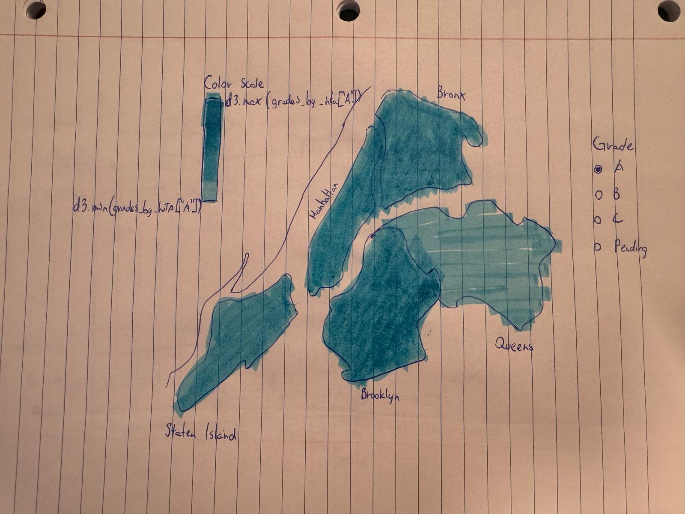

# How much does the share of A grades vary by borough and neighborhood?

A map of New York showing the share of restaurants with an A in each neighborhood. Zoom in from boroughs to neighborhoods to see where an A is more or less common.

## Data Transformation

**Goal:** For every borough and NTA (Neighborhood Tabulation Area), count how many restaurants have each grade, using each restaurant's most recent grade. Besides A, B and C, the data also has N (not yet graded), Z (grade pending) and P (grade pending after reopening). None of these are actual letter grades yet, so I put them together in one "Pending" group.

1. Get the `inspections` table, remove rows with no grade and sort by `inspection_date`
2. Group by `camis` and keep the last graded inspection, so there is one row per restaurant
3. Rename N, Z and P to "Pending"
4. Join with the `restaurants` table on `camis` to get each restaurant's `nta`
5. Get the borough from the first two letters of the NTA code (MN, BX, BK, QN, SI) instead of the `boro` column. The two only disagree for a few restaurants in Marble Hill, which is in Manhattan but has Bronx addresses
6. Count the restaurants per NTA for each grade group (`count_A`, `count_B`, `count_C`, `count_pending`, `total_count`). The borough table is the sum of its NTAs, so the borough totals match the map. The CSVs only store counts and the shares are calculated on the page

```js
const boroughs = FileAttachment("/data/q2-boro.csv").csv({typed: true});
const nta = FileAttachment("/data/q2-nta.csv").csv({typed: true});
```

## Grades by Borough

```js
display(Inputs.table(boroughs))
```

## Grades by NTA

```js
display(Inputs.table(nta))
```

## Chart Sketch
A map of New York where each area is colored by the share of its restaurants that have the selected grade. Darker means a higher share. The radio buttons on the right pick the grade (A, B, C or Pending), and the color scale on the left shows which share each color stands for. The map starts with the boroughs and you can zoom in to see the neighborhoods (NTAs).



<div class="note">
    <ul>
        <li>The boroughs color-wise look pretty similar because their A-share are close. Lowest is Queens with 75.5% and highest is Manhattan and Brox with 80.1%.</li>
        <li>Why does each grade have its own color scale? Because the shares are very different. Most restaurants have an A, and only a few have a B or a C. On the A scale, every area would look the same color for B and C.</li>
        <li>Why do the boroughs and the neighborhoods use the same scale? So a color always means the same share. If the borough view had its own scale, small differences between boroughs would look big and the colors would change when you zoom in.</li>
    </ul>
</div>