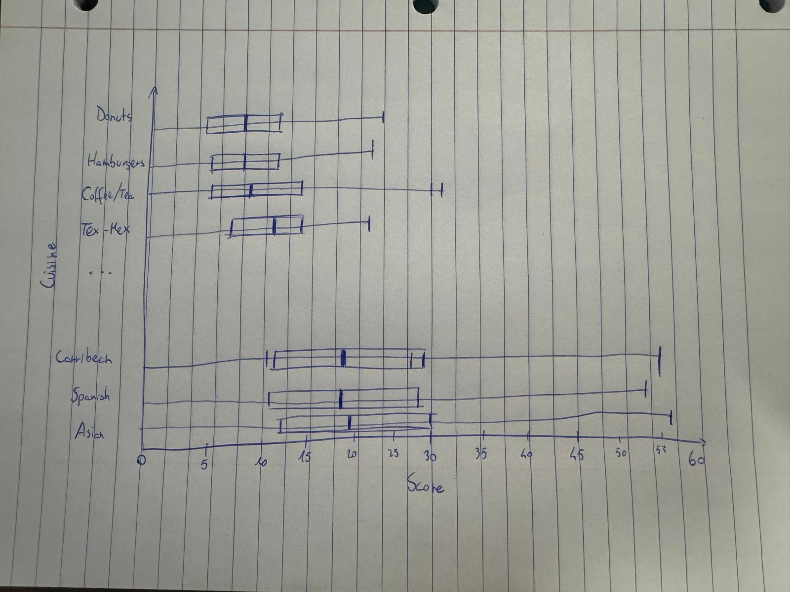

# How much do scores differ by cuisine?

The median and spread of first-inspection scores for every cuisine with at least ${q3.min_count} first inspections. A first inspection is the routine unannounced visit that starts each inspection cycle, so every restaurant is checked the same way.

## Data Transformation

**Goal:** For each cuisine with at least ${q3.min_count} first inspections, get the numbers needed for a box plot of first-inspection scores: the number of inspections and restaurants, the quartiles, the whiskers and the outliers past them.

1. Get the `inspections` table and keep only first inspections ("Cycle Inspection / Initial Inspection") from ${q3.start} to ${q3.end} that have a score, the same inspections as Q1 (${format(q3.inspections_in_window)})
2. Join with the `restaurants` table on `camis` to get each restaurant's `cuisine_description`. Keep only `restaurants` with a non-empty `cuisine_description` (${format(q3.no_cuisine_left_out)} first inspections have none)
3. Remove "Other" and "Bottled Beverages" because they are not cuisines (${format(q3.not_cuisine_left_out)} first inspections). Keep only cuisines with at least ${q3.min_count} first inspections, so each box is based on enough data: this leaves out ${q3.small_cuisines} cuisines with ${format(q3.small_cuisines_left_out)} first inspections between them. In the chart, each box is colored by its number of inspections, from light (few) to dark (many), because boxes based on fewer inspections are less reliable
4. Group by `cuisine_description` and calculate `count` (number of first inspections), `restaurants` (number of different restaurants), `percentile_25`, `median` and `percentile_75`
5. Calculate the whiskers. The interquartile range (IQR) is `percentile_75 - percentile_25`. `whisker_high` is the highest score that is not above `percentile_75 + 1.5 × IQR`, and `whisker_low` is the lowest score that is not below `percentile_25 - 1.5 × IQR`. Scores past the whiskers are not drawn, because a few very high scores would stretch the axis and make the boxes too small to compare. Instead, `outliers` counts them and `max_score` keeps the highest one, so the chart can label what it leaves out. All outliers are high scores: the lower limit is below 0 for every cuisine
6. Sort by median
7. Save the numbers quoted on this page (window, snapshot, counts left out at each step) to `q3-summary.json`, so the text updates with the data

The table keeps ${format(q3.inspections)} first inspections of ${format(q3.restaurants)} restaurants in ${q3.cuisines} cuisines. ${format(q3.outliers)} of them (${d3.format(".1%")(q3.share_outliers)}) are outliers past the upper whisker.

**Reading the comparison:** a restaurant can have more than one first inspection in the window (one per inspection cycle), so `count` is larger than `restaurants`, and the inspections of the same restaurant are not independent: a cuisine with a few restaurants that often score high can look worse than it is. The boxes describe the scores each cuisine got, not why: cuisine is mixed up with other differences such as the size, age and location of the restaurants, so the data do not show that the cuisine itself causes higher or lower scores.

**Changes since earlier milestones:** Milestone 2 used every first inspection in the file. Q3 now uses the same window as Q1, Q5 and Q6, so the counts and a few medians differ slightly from the Milestone 2 table, and the table adds the `restaurants`, `outliers` and `max_score` columns.

```js
const cuisines = FileAttachment("/data/q3-cuisines.csv").csv({typed: true});
const q3 = FileAttachment("/data/q3-summary.json").json();
const format = d3.format(",");
```

## Scores by Cuisine

```js
display(Inputs.table(cuisines, {
  layout: "auto",
  header: {
    cuisine: "Cuisine",
    count: "First inspections",
    restaurants: "Restaurants",
    percentile_25: "25th percentile",
    median: "Median",
    percentile_75: "75th percentile",
    whisker_low: "Lower whisker",
    whisker_high: "Upper whisker",
    outliers: "Outliers (past the upper whisker)",
    max_score: "Highest score"
  }
}))
```

## Chart Sketch
A box plot with one row per cuisine, sorted by median score, and the first-inspection score on the x-axis (lower scores are better). Each box goes from the 25th to the 75th percentile with a line at the median, and the whiskers show how far the usual scores go. Each box is colored by the number of first inspections of the cuisine, from light (few) to dark (many) using a sequential color scale. Hovering a box shows the cuisine, its number of first inspections, the quartiles and the whiskers.



<div class="note">
    <ul>
        <li>I haven't colored the IQRs in the sketch. Some cuisines have only 50 first inspections while others have several thousand, so I thought of using a color channel to show this difference. This helps decide how credible medians with a low count are.</li>
    </ul>
</div>

## D3 Chart (made by Claude)

```js
const sortBy = view(Inputs.radio(["Median score", "First inspections", "Cuisine name"], {label: "Sort by", value: "Median score"}));
```

```js
display(cuisineBoxPlot(cuisines, {width, sortBy}));
```

<p class="q3-caption">${format(q3.inspections)} routine first inspections of ${format(q3.restaurants)} restaurants from ${q3.start} to ${q3.end}, in the ${q3.cuisines} cuisines with at least ${q3.min_count} first inspections, from the ${q3.snapshot.match(/\d{4}-\d{2}-\d{2}/)[0]} snapshot. Lower scores are better.</p>

- Each row is a cuisine. The box goes from the 25th to the 75th percentile, the dark tick is the median and the whiskers show how far the usual scores go. The dashed line marks the A cutoff: a score of 13 or less earns an A.
- The box color and the "First Inspections" column both show how many first inspections a cuisine has. Lighter boxes are based on fewer inspections, so their medians are less reliable.
- The "Outliers" column counts the scores past the upper whisker and gives the highest one, because the chart doesn't draw them, so the boxes stay readable (${format(q3.outliers)} in all, ${d3.format(".1%")(q3.share_outliers)} of the inspections).
- The radio buttons change the order of the rows. Hover a row to see its numbers, including how many different restaurants are behind the inspections.
- The boxes describe the scores, not their cause (see "Reading the comparison" above).

<div class="warning" label="AI Disclosure">
  I asked Claude (Opus 5.5) to make this chart. Claude wrote its code (the box plot, the count color scale and legend, the count and outlier columns, the A cutoff line, the sorting and the tooltip). Claude also added the restaurants, outliers and highest score columns and the summary file in the data processing.
</div>

```js
// Box plot of first-inspection scores, one row per cuisine, with the counts and the outliers written next to each row
function cuisineBoxPlot(data, {width, sortBy}) {
    const compact = width < 560;
    const format = d3.format(",");

    const sortOf = {
        "Median score": (a, b) => d3.ascending(a.median, b.median) || d3.descending(a.count, b.count),
        "First inspections": (a, b) => d3.descending(a.count, b.count),
        "Cuisine name": (a, b) => d3.ascending(a.cuisine, b.cuisine)
    };

    const rows = data.slice().sort(sortOf[sortBy]);

    // Two text columns on the right: the number of first inspections and the outliers not drawn
    const columns = {
        count: compact ? 44 : 110,
        outliers: compact ? 52 : 86
    };

    const margin = {
        top: 52,
        right: columns.count + columns.outliers + 8,
        bottom: 44,
        left: compact ? 112 : 190
    };

    const rowHeight = 18;

    const dims = {
        width: width,
        height: margin.top + rows.length * rowHeight + margin.bottom
    };

    const innerDims = {
        width: dims.width - margin.left - margin.right,
        height: dims.height - margin.top - margin.bottom
    };

    const x = d3.scaleLinear()
        .domain([0, d3.max(rows, d => d.whisker_high)])
        .nice()
        .range([0, innerDims.width]);

    const y = d3.scaleBand()
        .domain(rows.map(d => d.cuisine))
        .range([0, innerDims.height])
        .padding(0.25);

    // Light (few first inspections) to the brand color (many). Log scale: counts go from 50 to thousands
    const color = d3.scaleSequentialLog()
        .domain(d3.extent(rows, d => d.count))
        .interpolator(d3.interpolateRgb("#dcebf1", "#00688F"));

    const container = d3.create("div")
        .attr("class", "q3-boxplot");

    // Legend row: the box colors and the dashed A cutoff line
    const controls = container.append("div")
        .attr("class", "q3-controls");

    controls.append(() => colorLegend());

    const cutoffKey = controls.append("span")
        .attr("class", "q3-cutoff-key");

    cutoffKey.append("svg")
        .attr("width", 10)
        .attr("height", 22)
        .append("line")
        .attr("class", "q3-cutoff")
        .attr("x1", 5)
        .attr("x2", 5)
        .attr("y1", 0)
        .attr("y2", 22);

    cutoffKey.append("span")
        .text("A cutoff: a score of 13 or less earns an A");

    const chartSvg = container.append("svg")
        .attr("width", dims.width)
        .attr("height", dims.height)
        .attr("role", "img")
        .attr("aria-label", "Box plot of first-inspection scores for " + rows.length + " cuisines, sorted by " + sortBy.toLowerCase());

    const tooltip = container.append("div")
        .attr("class", "q3-tooltip")
        .style("opacity", 0);

    const chart = chartSvg.append("g")
        .attr("transform", "translate(" + margin.left + ", " + margin.top + ")");

    // Grid lines and score axes, at the top and the bottom because the chart is tall
    chart.append("g")
        .attr("class", "q3-grid")
        .call(d3.axisBottom(x)
            .ticks(compact ? 5 : 10)
            .tickSize(innerDims.height)
            .tickFormat(""))
        .call(axis => axis.select(".domain").remove());

    chart.append("g")
        .call(d3.axisTop(x).ticks(compact ? 5 : 10));

    chart.append("g")
        .attr("transform", "translate(0, " + innerDims.height + ")")
        .call(d3.axisBottom(x).ticks(compact ? 5 : 10));

    chart.append("text")
        .attr("class", "q3-axis-title")
        .attr("x", innerDims.width / 2)
        .attr("y", innerDims.height + 36)
        .attr("text-anchor", "middle")
        .text("First-inspection score (lower is better)");

    // A cutoff between 13 and 14 (moved on top of the boxes once they are drawn)
    const cutoffLine = chart.append("line")
        .attr("class", "q3-cutoff")
        .attr("x1", x(13.5))
        .attr("x2", x(13.5))
        .attr("y1", -6)
        .attr("y2", innerDims.height);

    chart.append("text")
        .attr("class", "q3-cutoff-label")
        .attr("x", x(13.5))
        .attr("y", -32)
        .attr("text-anchor", "middle")
        .text(compact ? "A cutoff" : "A cutoff (13 or less)");

    // Column headers
    const countX = innerDims.width + 8 + columns.count;
    const outliersX = countX + columns.outliers;

    chart.append("text")
        .attr("class", "q3-column-header")
        .attr("x", countX)
        .attr("y", -32)
        .attr("text-anchor", "end")
        .text(compact ? "Count" : "First Inspections");

    chart.append("text")
        .attr("class", "q3-column-header")
        .attr("x", outliersX)
        .attr("y", -32)
        .attr("text-anchor", "end")
        .text("Outliers");

    // One group per cuisine
    const rowGroups = chart.append("g")
        .selectAll("g")
        .data(rows)
        .join("g")
        .attr("class", "q3-row")
        .attr("transform", d => "translate(0, " + y(d.cuisine) + ")");

    // Invisible full-width rectangle, so the whole row reacts to hover
    rowGroups.append("rect")
        .attr("class", "q3-hover-target")
        .attr("x", -margin.left)
        .attr("y", -y.step() * y.paddingInner() / 2)
        .attr("width", dims.width)
        .attr("height", y.step());

    rowGroups.append("text")
        .attr("class", "q3-label")
        .attr("x", -8)
        .attr("y", y.bandwidth() / 2)
        .attr("dy", "0.35em")
        .attr("text-anchor", "end")
        .text(d => shortName(d.cuisine));

    // Whisker line and its two caps
    rowGroups.append("line")
        .attr("class", "q3-whisker")
        .attr("x1", d => x(d.whisker_low))
        .attr("x2", d => x(d.whisker_high))
        .attr("y1", y.bandwidth() / 2)
        .attr("y2", y.bandwidth() / 2);

    rowGroups.selectAll(".q3-cap")
        .data(d => [d.whisker_low, d.whisker_high])
        .join("line")
        .attr("class", "q3-whisker q3-cap")
        .attr("x1", d => x(d))
        .attr("x2", d => x(d))
        .attr("y1", y.bandwidth() * 0.2)
        .attr("y2", y.bandwidth() * 0.8);

    // Box from the 25th to the 75th percentile, colored by the number of first inspections
    rowGroups.append("rect")
        .attr("class", "q3-box")
        .attr("x", d => x(d.percentile_25))
        .attr("y", 0)
        .attr("width", d => Math.max(1, x(d.percentile_75) - x(d.percentile_25)))
        .attr("height", y.bandwidth())
        .attr("fill", d => color(d.count));

    // Median tick, a bit taller than the box so it shows on light and dark boxes
    rowGroups.append("line")
        .attr("class", "q3-median")
        .attr("x1", d => x(d.median))
        .attr("x2", d => x(d.median))
        .attr("y1", -2)
        .attr("y2", y.bandwidth() + 2);

    // Counts written next to each row
    rowGroups.append("text")
        .attr("class", "q3-number")
        .attr("x", countX)
        .attr("y", y.bandwidth() / 2)
        .attr("dy", "0.35em")
        .attr("text-anchor", "end")
        .text(d => format(d.count));

    rowGroups.append("text")
        .attr("class", "q3-number q3-muted")
        .attr("x", outliersX)
        .attr("y", y.bandwidth() / 2)
        .attr("dy", "0.35em")
        .attr("text-anchor", "end")
        .text(d => outliersText(d));

    // Hover: fade the other rows and show the numbers of this one
    rowGroups
        .on("pointerenter", (event, d) => {
            rowGroups.classed("q3-faded", row => row !== d);
        })
        .on("pointermove", (event, d) => showTooltip(event, rowText(d)))
        .on("pointerleave", () => {
            rowGroups.classed("q3-faded", false);
            hideTooltip();
        });

    cutoffLine.raise();

    function shortName(name) {
        const maxLength = compact ? 16 : 30;
        return name.length > maxLength ? name.slice(0, maxLength - 1) + "…" : name;
    }

    function outliersText(d) {
        if (d.outliers === 0) return "none";
        if (compact) return "+" + format(d.outliers);
        return format(d.outliers) + ", max " + d.max_score;
    }

    function rowText(d) {
        let text = "<strong>" + d.cuisine + "</strong><br>"
            + format(d.count) + " first inspections of " + format(d.restaurants) + " restaurants<br>"
            + "Median " + d.median + ", middle half " + d.percentile_25 + " to " + d.percentile_75 + "<br>"
            + "Whiskers " + d.whisker_low + " to " + d.whisker_high + "<br>";

        if (d.outliers === 0) return text + "No outliers past the upper whisker";
        return text + format(d.outliers) + (d.outliers === 1 ? " outlier" : " outliers") + " above " + d.whisker_high + " (up to " + d.max_score + "), not drawn";
    }

    function showTooltip(event, html) {
        const [pointerX, pointerY] = d3.pointer(event, container.node());

        tooltip
            .style("opacity", 1)
            .style("left", Math.max(0, Math.min(pointerX + 14, dims.width - 260)) + "px")
            .style("top", (pointerY + 16) + "px")
            .html(html);
    }

    function hideTooltip() {
        tooltip.style("opacity", 0);
    }

    // Gradient legend for the number of first inspections
    function colorLegend() {
        const legendDims = {
            width: 240,
            height: 44
        };

        const legendSvg = d3.create("svg")
            .attr("width", legendDims.width + 16)
            .attr("height", legendDims.height);

        const legendX = d3.scaleLog()
            .domain(color.domain())
            .range([0, legendDims.width]);

        legendSvg.append("text")
            .attr("x", 0)
            .attr("y", 10)
            .attr("font-weight", "bold")
            .text("First inspections per cuisine");

        legendSvg.append("g")
            .selectAll("rect")
            .data(d3.range(0, 1, 1 / 64))
            .join("rect")
            .attr("x", t => t * legendDims.width)
            .attr("y", 16)
            .attr("width", legendDims.width / 64 + 0.5)
            .attr("height", 10)
            .attr("fill", t => color(legendX.invert(t * legendDims.width)));

        const tickValues = [50, 100, 500, 1000, 5000]
            .filter(value => value >= color.domain()[0] && value <= color.domain()[1]);

        legendSvg.append("g")
            .attr("transform", "translate(0, 26)")
            .call(d3.axisBottom(legendX)
                .tickValues(tickValues)
                .tickFormat(format)
                .tickSize(4))
            .call(axis => axis.select(".domain").remove());

        return legendSvg.node();
    }

    return container.node();
}
```

## What It Shows

```js
// Numbers quoted below, computed from the cuisine table
const byMedian = d3.sort(cuisines, d => d.median);
const largeCuisines = byMedian.filter(d => d.count >= 1000);
const medianText = d => d.cuisine + " (" + d.median + ")";
```

- **Most cuisines have a median in the A range:** ${cuisines.filter(d => d.median <= 13).length} of the ${q3.cuisines} cuisines have a median of 13 or less, and ${cuisines.filter(d => d.median === 13).length} sit exactly at 13, the last A score: the same pile-up at the cutoff as in Q1.
- **Lowest and highest:** the lowest medians are ${byMedian.slice(0, 3).map(medianText).join(", ")}, and the highest are ${byMedian.slice(-3).reverse().map(medianText).join(", ")}. The extremes include small cuisines (lighter boxes), whose medians are less reliable.
- **Among the large cuisines:** for the ${largeCuisines.length} cuisines with at least 1,000 first inspections, medians go from ${largeCuisines[0].median} (${largeCuisines[0].cuisine}) to ${largeCuisines.at(-1).median} (${largeCuisines.at(-1).cuisine}).
- **The boxes overlap a lot:** in ${cuisines.filter(d => d.percentile_25 <= 13 && d.percentile_75 >= 14).length} of the ${q3.cuisines} cuisines the box crosses the A cutoff, so within almost every cuisine some first inspections are well inside the A range and others miss it. Cuisine alone says little about how a single restaurant will score.
- **Not a cause:** the boxes describe the scores, not why they differ (see "Reading the comparison" above).

<style>
.q3-boxplot {
  position: relative;
  font: 11px var(--sans-serif);
  max-width: 100%;
}
.q3-boxplot svg {
  display: block;
  max-width: 100%;
  overflow: visible;
}
.q3-boxplot text {
  fill: var(--theme-foreground);
}
.q3-controls {
  display: flex;
  flex-wrap: wrap;
  align-items: center;
  gap: 8px 24px;
  margin-bottom: 4px;
}
.q3-cutoff-key {
  display: flex;
  align-items: center;
  gap: 6px;
  color: var(--theme-foreground);
}
.q3-grid line {
  stroke: var(--theme-foreground);
  stroke-opacity: 0.08;
}
.q3-axis-title,
.q3-column-header {
  font-weight: bold;
}
/* red so the cutoff stands out from the blue boxes and the gray whiskers */
.q3-cutoff {
  stroke: #d32f2f;
  stroke-width: 2;
  stroke-dasharray: 6 4;
  pointer-events: none;
}
.q3-boxplot .q3-cutoff-label {
  fill: #d32f2f;
  font-weight: bold;
}
.q3-row {
  transition: opacity 0.15s;
}
.q3-hover-target {
  fill: transparent;
}
.q3-row:hover .q3-hover-target {
  fill: var(--theme-foreground);
  fill-opacity: 0.05;
}
.q3-whisker {
  stroke: var(--theme-foreground-muted);
}
.q3-box {
  stroke: #00688F;
  stroke-width: 1;
}
.q3-median {
  stroke: var(--theme-foreground);
  stroke-width: 2.5;
}
.q3-number {
  font-variant-numeric: tabular-nums;
}
.q3-boxplot .q3-muted {
  fill: var(--theme-foreground-muted);
}
.q3-faded {
  opacity: 0.3;
}
.q3-tooltip {
  position: absolute;
  pointer-events: none;
  max-width: 250px;
  padding: 6px 8px;
  border: 1px solid var(--theme-foreground-faint);
  border-radius: 4px;
  background: var(--theme-background);
  color: var(--theme-foreground);
  box-shadow: 0 2px 6px rgba(0, 0, 0, 0.12);
  transition: opacity 0.1s;
}
.q3-caption {
  color: var(--theme-foreground-muted);
  font-size: 13px;
}
</style>
