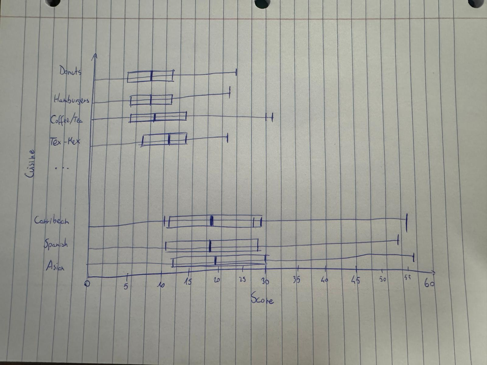

# How much do scores differ by cuisine?

The median and spread of first-inspection scores for every cuisine with at least 50 first inspections. A first inspection is the routine unannounced visit that starts each inspection cycle, so every restaurant is checked the same way.

## Data Transformation

**Goal:** For each cuisine with at least 50 first inspections, get the numbers needed for a box plot of first-inspection scores: the number of inspections, the quartiles and the whiskers.

1. Get the `inspections` table and keep only first inspections ("Cycle Inspection / Initial Inspection") that have a score, same as Q1.
2. Join with the `restaurants` table on `camis` to get each restaurant's `cuisine_description`. Keep only `restaurants` with a non-null `cuisine_description`
3. Remove "Other" and "Bottled Beverages" because they are not cuisines. Keep only cuisines with at least 50 first inspections, so each box is based on enough data. In the chart, each box is colored by its number of inspections, from light (few) to dark (many), because boxes based on fewer inspections are less reliable
4. Group by `cuisine_description` and calculate `count` (number of inspections), `percentile_25`, `median` and `percentile_75`
5. Calculate the whiskers. The interquartile range (IQR) is `percentile_75 - percentile_25`. `whisker_high` is the highest score that is not above `percentile_75 + 1.5 × IQR`, and `whisker_low` is the lowest score that is not below `percentile_25 - 1.5 × IQR`. Scores past the whiskers are left out, because a few very high scores would stretch the axis and make the boxes too small to compare
6. Sort by median

```js
const cuisines = FileAttachment("/data/q3-cuisines.csv").csv({typed: true});
```

## Scores by Cuisine

```js
display(Inputs.table(cuisines, {
  layout: "auto",
  header: {
    cuisine: "Cuisine",
    count: "First inspections",
    percentile_25: "25th percentile",
    median: "Median",
    percentile_75: "75th percentile",
    whisker_low: "Lower whisker",
    whisker_high: "Upper whisker"
  }
}))
```

## Chart Sketch
A box plot with one row per cuisine, sorted by median score, and the first-inspection score on the x-axis (lower scores are better). Each box goes from the 25th to the 75th percentile with a line at the median, and the whiskers show how far the usual scores go. Each box is colored by the number of first inspections of the cuisine, from light (few) to dark (many) using a sequential color scale. Hovering a box shows the cuisine, its number of first inspections, the quartiles and the whiskers.



<div class="note">
    <ul>
        <li>I haven't colored the IQRs in the sketch. Some cuisines have only 50 first inspections while others have several thousand, so I thought of using a color channel to show this difference. This helps decide how credible medians with a low count are.</li>
    </ul>
</div>