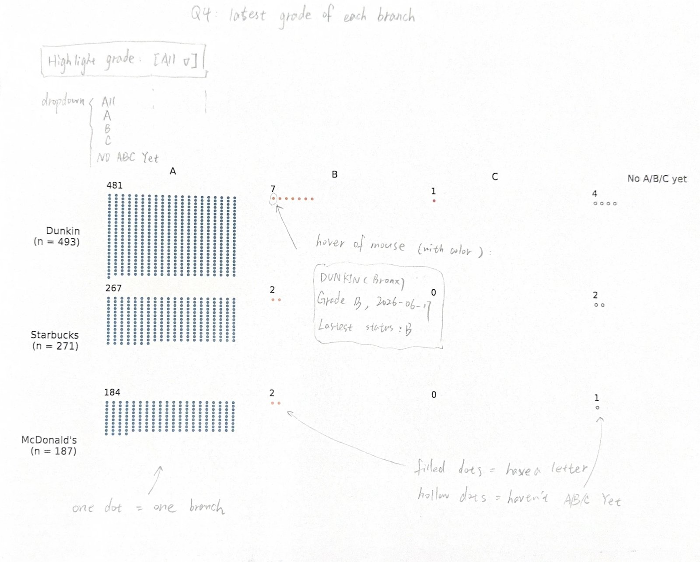

# Do branches of the same chain get similar grades?

We compare Dunkin, Starbucks and McDonald's. One CAMIS is one branch.

<div class="tip">
  <strong>Grade definition (same as Q2):</strong> a restaurant's grade is the grade of its most recent graded inspection, which is the card it posts now. A later Grade Pending (Z or P) or Not Yet Graded (N) replaces an earlier A, B or C. The branch list still shows that earlier letter and its date. The A share is out of all branches with a grade, like in Q2.
</div>

```js
const summary = FileAttachment("/data/q4-chain-summary.csv").csv({typed: true});
const branches = FileAttachment("/data/q4-branches.csv").csv({typed: true});
```

## How we found the branches

We look for DUNKIN, STARBUCKS or MCDONALD in the name, and keep the ones that start with the brand. Combo stores like "DUNKIN / BASKIN ROBBINS" are out, because one grade is for two brands. 12 names were unclear, like ferry shops and shared counters, so we checked them by hand. Only the Pace University Starbucks counts.

## Grades per chain

```js
display(Inputs.table(summary, {
  layout: "auto",
  select: false,
  columns: ["chain", "branches", "A", "B", "C", "grade_pending", "not_graded", "never_graded", "pct_A"],
  header: {chain: "Chain", branches: "Branches", grade_pending: "Grade Pending", not_graded: "Not Yet Graded", never_graded: "Never graded", pct_A: "% A (of branches with a grade)"}
}));
```

## Branch list

```js
const grade = view(Inputs.select(["All", "A", "B", "C", "Grade Pending", "Not Yet Graded", "Never graded"], {label: "Grade"}));
```

```js
const day = d => d instanceof Date ? d.toISOString().slice(0, 10) : d;
const shown = branches
  .filter(d => d.in_sample)
  .filter(d => grade === "All" || (grade === "Never graded" ? !d.card : d.card === grade));
display(Inputs.table(shown, {
  layout: "auto",
  select: false,
  columns: ["chain", "camis", "dba", "boro", "card", "grade_date", "latest_letter", "latest_letter_date", "last_status"],
  header: {chain: "Chain", camis: "CAMIS", dba: "Name", boro: "Borough", card: "Grade", grade_date: "Grade date", latest_letter: "Latest letter", latest_letter_date: "Letter date", last_status: "Last inspection's grade"},
  format: {camis: d => String(d), grade_date: day, latest_letter_date: day}
}));
```

## Simple analysis from the vision

All three chains are mostly A: between ${d3.min(summary, d => d.pct_A)}% and ${d3.max(summary, d => d.pct_A)}% of branches with a grade. Across ${d3.sum(summary, d => d.branches)} branches there are only ${d3.sum(summary, d => d.B)} B's and ${d3.sum(summary, d => d.C)} C's.

## Planned chart

Base chart is firstly drawn by python(matplotlib), then add some elements by hand.



Each chain is a row and each grade is a column: A, B, C and no A/B/C yet. Each dot is one branch, and a hollow dot means no letter. Each row shows its n. When you hover a dot, it shows the branch name, borough, grade date and latest status.

The sketch was drawn with the earlier grade definition (latest A, B or C). The chart will use the definition above, so the "no A/B/C yet" column becomes two columns, Grade Pending and Not Yet Graded.
