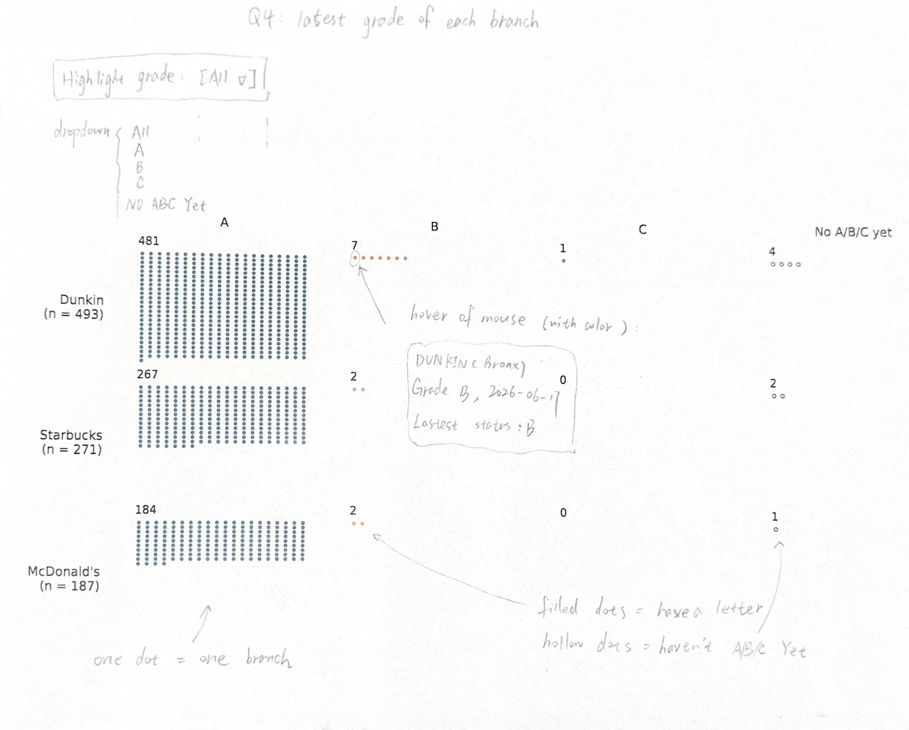

# Do branches of the same chain get similar grades?

We compare Dunkin, Starbucks and McDonald's. One CAMIS is one branch. Its grade is the latest A, B or C it got, and a later N, Z or P doesn't replace it.

```js
const summary = FileAttachment("/data/q4-chain-summary.csv").csv({typed: true});
const branches = FileAttachment("/data/q4-branches.csv").csv({typed: true});
```

## How we found the branches

We look for DUNKIN, STARBUCKS or MCDONALD in the name, and keep the ones that start with the brand. Combo stores like "DUNKIN / BASKIN ROBBINS" are out, because one grade is for two brands. 12 names were unclear, like ferry shops and shared counters, so we checked them by hand. Only the Pace University Starbucks counts.

## Grades per chain

```js
display(Inputs.table(summary, {
  layout: "auto",
  select: false,
  columns: ["chain", "branches", "A", "B", "C", "no_grade", "pct_A"],
  header: {chain: "Chain", branches: "Branches", no_grade: "No A/B/C yet", pct_A: "% A (of graded)"}
}));
```

## Branch list

```js
const grade = view(Inputs.select(["All", "A", "B", "C", "No A/B/C yet"], {label: "Grade"}));
```

```js
const shown = branches
  .filter(d => d.in_sample)
  .filter(d => grade === "All" || (grade === "No A/B/C yet" ? !d.grade : d.grade === grade));
display(Inputs.table(shown, {
  layout: "auto",
  select: false,
  columns: ["chain", "camis", "dba", "boro", "grade", "grade_date", "last_status"],
  header: {chain: "Chain", camis: "CAMIS", dba: "Name", boro: "Borough", grade: "Grade", grade_date: "Grade date", last_status: "Latest status"},
  format: {camis: d => String(d), grade_date: d => d instanceof Date ? d.toISOString().slice(0, 10) : d}
}));
```

## Simple analysis from the vision

All three chains are about 98-99% A. Only 11 B's and one C in 951 branches.

## Planned chart

Base chart is firstly drawn by python(matplotlib), then add some elements by hand.



Each chain is a row and each grade is a column: A, B, C and no A/B/C yet. Each dot is one branch, and a hollow dot means no letter. Each row shows its n. When you hover a dot, it shows the branch name, borough, grade date and latest status.
