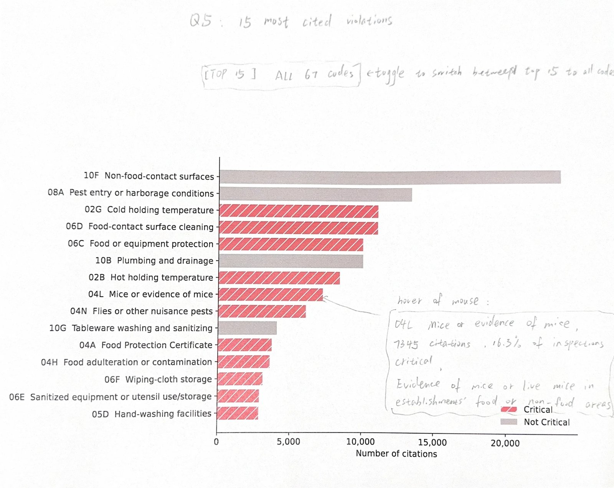

# Which violations are cited most often, and what share are critical?

The proposal asked which violations "drive scores up". The data gives the total score of an inspection, yet not the points from each violation. So we count how often each code shows up and how many are critical.

```js
const info = FileAttachment("/data/q5-summary.json").json();
const codes = FileAttachment("/data/q5-code-summary.csv").csv({typed: true});
const flags = FileAttachment("/data/q5-critical-summary.csv").csv({typed: true});
```

## Data

We use **${d3.format(",")(info.inspections)} routine initial inspections** (Cycle Inspection / Initial Inspection) from ${info.start} to ${info.end}. They have ${d3.format(",")(info.violation_rows)} violation rows; after dropping ${info.duplicates_dropped} exact duplicates there are **${d3.format(",")(info.citations)} citations** across ${info.codes} codes.

We use the critical flag on each row. 09A has both flags.

## Critical share

```js
display(Inputs.table(flags, {
  layout: "auto",
  select: false,
  columns: ["flag", "citations", "pct_citations"],
  header: {flag: "Flag", citations: "Citations", pct_citations: "% of citations"}, format: {pct_citations: d=> d.toFixed(1)}
}));
```

## Most cited codes

```js
const show = view(Inputs.select(["Top 15", "All codes"], {label: "Show"}));
```

```js
display(Inputs.table(show === "Top 15" ? codes.slice(0, 15) : codes, {
  layout: "auto",
  select: false,
  columns: ["code", "label", "citations", "critical", "not_critical", "pct_inspections"],
  header: {code: "Code", label: "Violation", citations: "Citations", critical: "Critical", not_critical: "Not Critical", pct_inspections: "% of inspections"},
  width: {code: 50, label: 260}, format: {pct_inspections: d=> d.toFixed(1)}
}));
```

One inspection can have many codes, so this column adds up to more than 100%.

## Planned chart

Base chart is firstly drawn by python(matplotlib), then add some elements by hand.



Bars for the top 15 codes, sorted by count, and the x-axis starts at 0. Each bar is split into Critical and Not Critical. When you hover a bar, it shows the full description and the % of inspections. A toggle switches to all codes.

## D3 Chart

The bars count how often each code is cited. The scatter after them shows how the score looks when a code is there.

### 1. How often each code is cited

```js
const barsShown = view(Inputs.radio(["Top 15", "All codes"], {label: "Show", value: "Top 15"}));
```

```js
display(violationBars(barsShown === "Top 15" ? codes.slice(0, 15) : codes));
```

<p class="q5-caption">Bar length is number of citations. ${d3.format(",")(info.citations)} citations in ${info.codes} codes, from ${d3.format(",")(info.inspections)} routine initial inspections between ${info.start} and ${info.end}. The city's file keeps about three years of inspections, so 2023 is only partly covered. Hover a bar to see the full description.</p>

```js
function violationBars(data) {
  const width = 900;
  const marginLeft = 330;
  const rowHeight = 22;
  const height = data.length * rowHeight + 50;


  const x = d3.scaleLinear()
      .domain([0, d3.max(data, d => d.citations)]).nice()
      .range([marginLeft, width - 70]);
  const y = d3.scaleBand()
      .domain(data.map(d => d.code))
      .range([40, height - 10])
      .padding(0.2);
  const short = text => text.length > 42 ? text.slice(0, 40) + "…" : text;


  const container = d3.create("div").style("position", "relative");


  // legend
  container.append("div").attr("class", "q5-legend").html(`
    <span><svg width="14" height="14"><rect width="14" height="14" fill="url(#q5-hatch)"/></svg> Critical</span>
    <span><svg width="14" height="14"><rect width="14" height="14" fill="#cdbfa8"/></svg> Not Critical</span>`);


  const svg = container.append("svg")
      .attr("viewBox", [0, 0, width, height])
      .style("width", "100%")
      .style("font", "12px sans-serif");


  // Critical is red with white stripes
  const hatch = svg.append("defs").append("pattern")
      .attr("id", "q5-hatch")
      .attr("width", 6).attr("height", 6)
      .attr("patternUnits", "userSpaceOnUse")
      .attr("patternTransform", "rotate(45)");
  hatch.append("rect").attr("width", 6).attr("height", 6).attr("fill", "#d64550");
  hatch.append("line").attr("x1", 0).attr("y1", 0).attr("x2", 0).attr("y2", 6).attr("stroke", "white").attr("stroke-width", 1.5);


  svg.append("g")
      .attr("transform", "translate(0,40)")
      .call(d3.axisTop(x).ticks(6).tickFormat(d3.format(",")))
      .call(g => g.select(".domain").remove());
  svg.append("text")
      .attr("x", width - 70).attr("y", 12)
      .attr("text-anchor", "end").attr("fill", "#666")
      .text("Citations");


  svg.append("g")
    .selectAll("text").data(data).join("text")
      .attr("x", marginLeft - 8)
      .attr("y", d => y(d.code) + y.bandwidth() / 2)
      .attr("dy", "0.35em")
      .attr("text-anchor", "end")
      .text(d => `${d.code}  ${short(d.label)}`);


  // one bar per code: Critical first, then Not Critical
  const parts = [];
  for (const d of data) {
    parts.push({d, start: 0, end: d.critical, fill: "url(#q5-hatch)"});
    parts.push({d, start: d.critical, end: d.critical + d.not_critical, fill: "#cdbfa8"});
  }


  const tip = container.append("div").attr("class", "q5-tip");


  svg.append("g")
    .selectAll("rect").data(parts).join("rect")
      .attr("x", p => x(p.start))
      .attr("y", p => y(p.d.code))
      .attr("width", p => x(p.end) - x(p.start))
      .attr("height", y.bandwidth())
      .attr("fill", p => p.fill)
      .on("mouseenter", (event, p) => {
        const d = p.d;
        tip.style("opacity", 1).html(`<b>${d.code} ${d.label}</b><br>
          ${d3.format(",")(d.citations)} citations: ${d3.format(",")(d.critical)} Critical, ${d3.format(",")(d.not_critical)} Not Critical<br>
          In ${d.pct_inspections.toFixed(1)}% of inspections<br>
          <span class="q5-desc">${d.description}</span>`);
      })
      .on("mousemove", event => {
        const [px, py] = d3.pointer(event, container.node());
        tip.style("left", `${Math.min(px + 12, container.node().clientWidth - 310)}px`).style("top", `${py + 12}px`);
      })
      .on("mouseleave", () => tip.style("opacity", 0));


  svg.append("g")
    .selectAll("text").data(data).join("text")
      .attr("x", d => x(d.citations) + 5)
      .attr("y", d => y(d.code) + y.bandwidth() / 2)
      .attr("dy", "0.35em")
      .attr("fill", "#666")
      .text(d => d3.format(",")(d.citations));


  return container.node();
}
```

### 2. Codes and missed A's

```js
const bigCodes = codes.filter(d => d.citations >= 100);
display(codeScatter(bigCodes, info.pct_missed_a));
```

<p class="q5-caption">One dot is one violation code, the ${bigCodes.length} codes with at least 100 citations. The x axis is how often the code is cited, on a log scale. The y axis is how many of the inspections with that code missed an A. The dashed line is all routine initial inspections from ${info.start} to ${info.end}. An inspection usually has several codes, so the chart can't tell how many points one code adds.</p>

```js
function codeScatter(data, cityMissed) {
  const width = 900;
  const height = 520;
  const margin = {top: 24, right: 40, bottom: 56, left: 66};
  const labeled = ["10F", "08A", "02G", "06D", "10B", "02B", "04L", "04N", "04M", "05D", "04A", "10G"];


  const x = d3.scaleLog()
      .domain([0.2, 60])
      .range([margin.left, width - margin.right]);
  const y = d3.scaleLinear()
      .domain([0, 100])
      .range([height - margin.bottom, margin.top]);
  const isCritical = d => d.critical >= d.not_critical;


  const container = d3.create("div").style("position", "relative");
  container.append("div").attr("class", "q5-legend").html(`
    <span><svg width="14" height="14"><circle cx="7" cy="7" r="6" fill="#d64550"/></svg> Mostly Critical</span>
    <span><svg width="14" height="14"><circle cx="7" cy="7" r="6" fill="#fffaf2" stroke="#a39887" stroke-width="1.5"/></svg> Mostly Not Critical</span>`);


  const svg = container.append("svg")
      .attr("viewBox", [0, 0, width, height])
      .style("width", "100%")
      .style("font", "12px sans-serif");
  const tip = container.append("div").attr("class", "q5-tip");


  svg.append("g")
      .attr("transform", `translate(0,${height - margin.bottom})`)
      .call(d3.axisBottom(x).tickValues([0.25, 0.5, 1, 2, 5, 10, 20, 50]).tickFormat(d => d + "%"));
  svg.append("text")
      .attr("x", (margin.left + width - margin.right) / 2).attr("y", height - 10)
      .attr("text-anchor", "middle").attr("fill", "#666")
      .text("Share of inspections with the code (log scale)");


  // light grid lines behind the dots
  svg.append("g").selectAll("line").data(y.ticks(5)).join("line")
      .attr("x1", margin.left).attr("x2", width - margin.right)
      .attr("y1", d => y(d)).attr("y2", d => y(d))
      .attr("stroke", "#efe9e1");
  svg.append("g")
      .attr("transform", `translate(${margin.left},0)`)
      .call(d3.axisLeft(y).ticks(5).tickFormat(d => d + "%"));
  svg.append("text")
      .attr("transform", "rotate(-90)")
      .attr("x", -(height - margin.bottom + margin.top) / 2).attr("y", 16)
      .attr("text-anchor", "middle").attr("fill", "#666")
      .text("Inspections with the code that missed an A");


  svg.append("line")
      .attr("x1", margin.left).attr("x2", width - margin.right)
      .attr("y1", y(cityMissed)).attr("y2", y(cityMissed))
      .attr("stroke", "#3d3d3d").attr("stroke-dasharray", "6 4");
  svg.append("text")
      .attr("x", margin.left + 6).attr("y", y(cityMissed) - 6)
      .attr("fill", "#555")
      .text(`all inspections ${cityMissed.toFixed(1)}%`);


  svg.selectAll("circle").data(data).join("circle")
      .attr("cx", d => x(d.pct_inspections))
      .attr("cy", d => y(d.pct_missed_a))
      .attr("r", 6)
      .attr("fill", d => isCritical(d) ? "#d64550" : "#fffaf2")
      .attr("stroke", d => isCritical(d) ? "white" : "#a39887")
      .attr("stroke-width", 1.5)
      .on("mouseenter", (event, d) => {
        tip.style("opacity", 1).html(`<b>${d.code} ${d.label}</b><br>
          In ${d.pct_inspections.toFixed(1)}% of inspections, ${d3.format(",")(d.citations)} citations<br>
          ${d.pct_missed_a.toFixed(1)}% of them missed an A<br>
          ${d3.format(",")(d.critical)} Critical, ${d3.format(",")(d.not_critical)} Not Critical`);
      })
      .on("mousemove", event => {
        const [px, py] = d3.pointer(event, container.node());
        tip.style("left", `${Math.min(px + 12, container.node().clientWidth - 310)}px`).style("top", `${py + 12}px`);
      })
      .on("mouseleave", () => tip.style("opacity", 0));


  svg.selectAll(".code").data(data.filter(d => labeled.includes(d.code))).join("text")
      .attr("x", d => x(d.pct_inspections) + 9)
      .attr("y", d => y(d.pct_missed_a))
      .attr("dy", d => d.code === "05D" ? "1.2em" : "0.35em")  // 05D sits right next to 04M
      .attr("font-size", 11)
      .text(d => d.code);


  // notes next to 10F and 04M
  const note = (code, text, dx, dy) => {
    const d = data.find(d => d.code === code);
    svg.append("text")
        .attr("x", x(d.pct_inspections) + dx).attr("y", y(d.pct_missed_a) + dy)
        .attr("text-anchor", "end").attr("fill", "#444").attr("font-size", 11)
        .text(text);
  };
  note("10F", "the most cited code, about as bad as average", 30, 26);
  note("04M", "cockroaches: most of these inspections miss an A", -12, -14);


  return container.node();
}
```

## Simple analysis from the vision

```js
const topCode = codes[0];
// const code = c => codes.find(d => d.code === c);
const criticalShare = flags.find(d => d.flag === "Critical").pct_citations;
// const medianCritical = d3.median(bigCodes.filter(d => d.critical >= d.not_critical), d => d.pct_missed_a);
// const medianNotCritical = d3.median(bigCodes.filter(d => d.critical < d.not_critical), d => d.pct_missed_a);
```

- **${topCode.code} ${topCode.label}** is by far the most cited code, and it shows up in more than half of all inspections. It is Not Critical and sits right on the dashed line, so clean places and dirty places both get it.
- High up in the scatter are cockroaches 04M, hand washing facilities 05D and mice 04L. More than three quarters of the inspections with these codes missed an A. Once one of these is wrote down, a re-inspection is the normal next step.
- ${Math.round(criticalShare)}% of all citations are Critical, and the red Critical dots sit higher than the Not Critical ones. 10F is the only dot under the line, since the line counts clean inspections too.
- 08A pest entry or harborage, the second most cited code, is high as well. It is not Critical, but mice often come with it. Q6 is about the pests.

<style>
.q5-caption {
  font-size: 13px;
  color: #6b6f7a;
  border-left: 2px solid #d64550;
  padding-left: 10px;
}
.q5-legend {
  display: flex;
  gap: 16px;
  font-size: 12px;
  margin-bottom: 4px;
}
.q5-legend span {
  display: flex;
  align-items: center;
  gap: 4px;
}
.q5-tip {
  position: absolute;
  pointer-events: none;
  opacity: 0;
  background: #22223b;
  color: #f2e9e4;
  border-left: 4px solid #d64550;
  border-radius: 8px;
  padding: 8px 11px;
  font-size: 12.5px;
  line-height: 1.5;
  box-shadow: 0 6px 18px rgba(34, 34, 59, 0.25);
  max-width: 300px;
}
.q5-desc {
  color: #c9c4d6;
}
</style>
