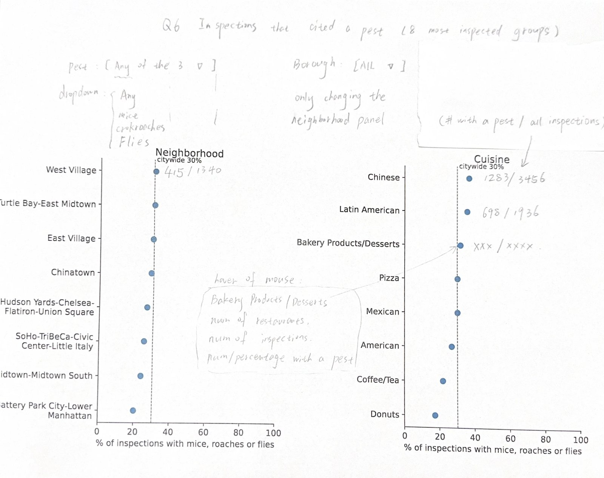

# Where do mice, cockroaches and flies show up most?

We compare how many inspections had mice, cockroaches or flies, by neighborhood (2010 NTA) and by cuisine. We use the same inspections as Q5, routine initial inspections from 2023 to October 2026.

```js
const info = FileAttachment("/data/q6-summary.json").json();
const pests = FileAttachment("/data/q6-pest-summary.csv").csv({typed: true});
const byNta = FileAttachment("/data/q6-by-nta.csv").csv({typed: true});
const byCuisine = FileAttachment("/data/q6-by-cuisine.csv").csv({typed: true});
```

## Which codes

| Code | Violation |
| --- | --- |
| 04L | Mice or evidence of mice |
| 04M | Cockroaches |
| 04N | Flies or other nuisance pests |

If one inspection has more than one of these, it counts once in "any".

## Citywide

Out of **${d3.format(",")(info.inspections)} inspections**, **${d3.format(",")(info.any_pest)} (${info.any_pest_pct}%)** had at least one of the three. ${info.missing_nta} inspections have no NTA. They are in the citywide number, but not in the neighborhood table.

```js
display(Inputs.table(pests, {
  layout: "auto",
  select: false,
  columns: ["label", "inspections", "pct_inspections"],
  header: {label: "Pest", inspections: "Inspections", pct_inspections: "% of inspections"}
}));
```

## Compare groups

```js
const by = view(Inputs.select(["Neighborhood", "Cuisine"], {label: "Compare by"}));
const pest = view(Inputs.select(new Map([["Any of the three", "any_pest"], ["Mice", "mice"], ["Cockroaches", "roaches"], ["Flies", "flies"]]), {label: "Pest"}));
```

The 20 groups with the most inspections (at least ${info.min_inspections}), sorted by rate.

```js
const rows = (by === "Neighborhood" ? byNta : byCuisine)
  .filter(d => d.compare)
  .slice(0, 20)
  .map(d => ({
    group: by === "Neighborhood" ? `${d.nta_name} (${d.nta})` : d.cuisine,
    inspections: d.inspections,
    restaurants: d.restaurants,
    count: d[pest],
    pct: d[`${pest}_pct`]
  }))
  .sort((a, b) => d3.descending(a.pct, b.pct));
display(Inputs.table(rows, {
  layout: "auto",
  select: false,
  columns: ["group", "inspections", "restaurants", "count", "pct"],
  header: {group: by, inspections: "Inspections", restaurants: "Restaurants", count: "With this pest", pct: "%"},
  width: {group: 300}
}));
```

## Planned chart

Base chart is firstly drawn by python(matplotlib), then add some elements by hand.



Two dot plots, one for neighborhoods and one for cuisines, on the same 0-100% axis. A dashed line shows the citywide rate. Each dot has its count next to it (with a pest / all inspections). There will be a switch for the three pests and "any", and a borough filter for neighborhoods. When you hover a dot, it shows how many restaurants and inspections.
