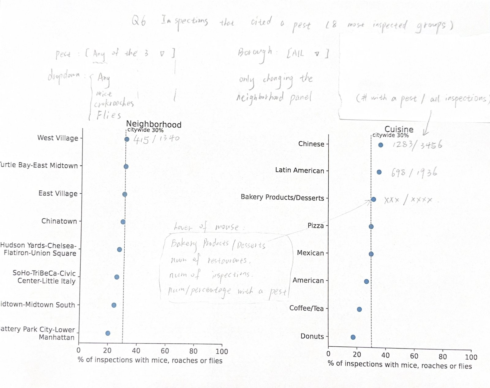

# Where do mice, cockroaches and flies show up most?

We compare how many inspections had mice, cockroaches or flies, by neighborhood (2010 NTA) and by cuisine. We use the same inspections as Q5, routine initial inspections from 2023 to October 2026.

```js
const info = FileAttachment("/data/q6-summary.json").json();
const pests = FileAttachment("/data/q6-pest-summary.csv").csv({typed: true});
const byNta = FileAttachment("/data/q6-by-nta.csv").csv({typed: true});
const byCuisine = FileAttachment("/data/q6-by-cuisine.csv").csv({typed: true});
```

## Which codes

| Code | Violation |
| --- | --- |
| 04L | Mice or evidence of mice |
| 04M | Cockroaches |
| 04N | Flies or other nuisance pests |

If one inspection has more than one of these, it counts once in "any".

## Citywide

Out of **${d3.format(",")(info.inspections)} inspections**, **${d3.format(",")(info.any_pest)} (${info.any_pest_pct}%)** had at least one of the three. ${info.missing_nta} inspections have no NTA. They are in the citywide number, but not in the neighborhood table.

```js
display(Inputs.table(pests, {
  layout: "auto",
  select: false,
  columns: ["label", "inspections", "pct_inspections"],
  header: {label: "Pest", inspections: "Inspections", pct_inspections: "% of inspections"}, format: {pct_inspections: d=> d.toFixed(1)}
}));
```

## Compare groups

```js
const by = view(Inputs.select(["Neighborhood", "Cuisine"], {label: "Compare by"}));
const pest = view(Inputs.select(new Map([["Any of the three", "any_pest"], ["Mice", "mice"], ["Cockroaches", "roaches"], ["Flies", "flies"]]), {label: "Pest"}));
```

The 20 groups with the most inspections (at least ${info.min_inspections}), sorted by rate.

```js
const rows = (by === "Neighborhood" ? byNta : byCuisine)
  .filter(d => d.compare)
  .slice(0, 20)
  .map(d => ({
    group: by === "Neighborhood" ? `${d.nta_name} (${d.nta})` : d.cuisine,
    inspections: d.inspections,
    restaurants: d.restaurants,
    count: d[pest],
    pct: d[`${pest}_pct`]
  }))
  .sort((a, b) => d3.descending(a.pct, b.pct));
display(Inputs.table(rows, {
  layout: "auto",
  select: false,
  columns: ["group", "inspections", "restaurants", "count", "pct"],
  header: {group: by, inspections: "Inspections", restaurants: "Restaurants", count: "With this pest", pct: "%"},
  width: {group: 300}, format: {pct: d=> d.toFixed(1)}
}));
```

## Planned chart

Base chart is firstly drawn by python(matplotlib), then add some elements by hand.



Two dot plots, one for neighborhoods and one for cuisines, on the same 0-100% axis. A dashed line shows the citywide rate. Each dot has its count next to it (with a pest / all inspections). There will be a switch for the three pests and "any", and a borough filter for neighborhoods. When you hover a dot, it shows how many restaurants and inspections.

## D3 Chart

```js
const chartPest = view(Inputs.select(new Map([["Any of the three", "any_pest"], ["Mice", "mice"], ["Cockroaches", "roaches"], ["Flies", "flies"]]), {label: "Pest"}));
const borough = view(Inputs.select(["All", "Manhattan", "Bronx", "Brooklyn", "Queens", "Staten Island"], {label: "Borough (neighborhoods)"}));
```

The two menus change both charts.

### 1. Pest map

```js
const ntaShapes = FileAttachment("/data/nta-2010.json").json();
```

```js
display(pestMap(ntaShapes, chartPest, borough));
```

<p class="q6-caption">Each 2010 NTA neighborhood is colored by the share of its inspections with the selected pest, darker is more. Gray means less than ${info.min_inspections} inspections, or parks and other areas with no restaurants. Picking a borough fades the other ones. Hover a neighborhood for its numbers. Routine initial inspections from ${info.start} to ${info.end}, ${info.missing_nta} of them have no NTA and are not on the map. The city's file keeps about three years of inspections, so 2023 is only partly covered.</p>

```js
function pestMap(topology, pest, borough) {
  const rowOf = new Map(byNta.map(d => [d.nta, d]));
  const features = topojson.feature(topology, topology.objects.ntas).features;
  const compared = byNta.filter(d => d.compare);
  const pct = d => d[`${pest}_pct`];
  const city = pests.find(d => d.pest === pest).pct_inspections;
  const pestName = {any_pest: "mice, roaches or flies", mice: "mice", roaches: "cockroaches", flies: "flies"}[pest];


  const width = 900;
  const height = 720;
  // cream to wine red
  const wine = d3.interpolateRgbBasis(["#fff7ec", "#f6b48f", "#d9534f", "#7b1e3a"]);
  const color = d3.scaleSequential(wine).domain(d3.extent(compared, pct));
  const projection = d3.geoMercator().fitExtent([[10, 50], [width - 10, height - 10]], {type: "FeatureCollection", features});
  const path = d3.geoPath(projection);


  const container = d3.create("div").style("position", "relative");
  const svg = container.append("svg")
      .attr("viewBox", [0, 0, width, height])
      .style("width", "100%")
      .style("font", "12px sans-serif");
  const tip = container.append("div").attr("class", "q6-tip");


  // legend from the lowest to the highest neighborhood, plus a tick for the citywide rate
  const legend = d3.scaleLinear().domain(color.domain()).range([20, 320]);
  const gradient = svg.append("defs").append("linearGradient").attr("id", "q6-gradient");
  gradient.selectAll("stop").data(d3.range(0, 1.01, 0.1)).join("stop")
      .attr("offset", t => `${t * 100}%`)
      .attr("stop-color", t => wine(t));
  svg.append("rect").attr("x", 20).attr("y", 20).attr("width", 300).attr("height", 10).attr("fill", "url(#q6-gradient)");
  svg.append("g")
      .attr("transform", "translate(0,30)")
      .call(d3.axisBottom(legend).tickValues([...color.domain(), city]).tickFormat(d => d.toFixed(0) + "%"))
      .call(g => g.select(".domain").remove());
  svg.append("text").attr("x", 20).attr("y", 14).attr("fill", "#666")
      .text(`Inspections with ${pestName}, the middle tick is the citywide rate`);


  svg.append("g")
    .selectAll("path").data(features).join("path")
      .attr("d", path)
      .attr("fill", f => {
        const row = rowOf.get(f.properties.nta);
        return row && row.compare ? color(pct(row)) : "#e6e1d8";
      })
      .attr("opacity", f => borough === "All" || f.properties.boro === borough ? 1 : 0.2)
      .attr("stroke", "white")
      .attr("stroke-width", 0.6)
      .on("mouseenter", function (event, f) {
        d3.select(this).attr("stroke", "black").attr("stroke-width", 1.5).raise();
        const row = rowOf.get(f.properties.nta);
        let numbers = "No restaurant inspections";
        if (row && row.compare) {
          numbers = `${d3.format(",")(row[pest])} of ${d3.format(",")(row.inspections)} inspections with ${pestName}, ${pct(row).toFixed(1)}%<br>${d3.format(",")(row.restaurants)} restaurants`;
        } else if (row) {
          numbers = `Only ${row.inspections} inspections, not compared`;
        }
        tip.style("opacity", 1).html(`<b>${f.properties.nta_name}</b> (${f.properties.boro})<br>${numbers}`);
      })
      .on("mousemove", event => {
        const [px, py] = d3.pointer(event, container.node());
        tip.style("left", `${Math.min(px + 12, container.node().clientWidth - 270)}px`).style("top", `${py + 12}px`);
      })
      .on("mouseleave", function () {
        d3.select(this).attr("stroke", "white").attr("stroke-width", 0.6);
        tip.style("opacity", 0);
      });


  return container.node();
}
```

### 2. Busiest neighborhoods and cuisines

```js
display(pestDots(chartPest, borough));
```

<p class="q6-caption">Each panel shows the 10 groups with the most inspections, at least ${info.min_inspections} each, sorted by rate. The label next to a dot is inspections with the pest / all inspections. The borough comes from the first two letters of the NTA code, like in Q2.</p>

```js
function pestDots(pest, borough) {
  const city = pests.find(d => d.pest === pest).pct_inspections;
  const pestName = {any_pest: "mice, roaches or flies", mice: "mice", roaches: "cockroaches", flies: "flies"}[pest];


  const panels = [
    {
      title: borough === "All" ? "Neighborhood (2010 NTA)" : `Neighborhood in ${borough}`,
      rows: byNta.filter(d => d.compare && (borough === "All" || boroughOf[d.nta.slice(0, 2)] === borough))
        .slice(0, 10).map(d => ({...d, name: d.nta_name, where: boroughOf[d.nta.slice(0, 2)]}))
    },
    {title: "Cuisine", rows: byCuisine.filter(d => d.compare).slice(0, 10).map(d => ({...d, name: d.cuisine}))}
  ];
  for (const panel of panels) panel.rows.sort((a, b) => d3.descending(a[`${pest}_pct`], b[`${pest}_pct`]));


  const panelWidth = 470;
  const labelWidth = 230;
  const rowHeight = 30;
  const height = 10 * rowHeight + 80;
  const short = text => text.length > 32 ? text.slice(0, 30) + "…" : text;


  const container = d3.create("div").style("position", "relative");
  const svg = container.append("svg")
      .attr("viewBox", [0, 0, panelWidth * 2, height])
      .style("width", "100%")
      .style("font", "12px sans-serif");
  const tip = container.append("div").attr("class", "q6-tip");


  panels.forEach((panel, i) => {
    const g = svg.append("g").attr("transform", `translate(${i * panelWidth},0)`);
    const x = d3.scaleLinear().domain([0, 100]).range([labelWidth, panelWidth - 30]);
    const y = d3.scalePoint().domain(panel.rows.map(d => d.name)).range([50, height - 40]);


    g.append("text").attr("x", labelWidth).attr("y", 14).attr("font-weight", "bold").text(panel.title);


    g.append("g")
        .attr("transform", `translate(0,${height - 25})`)
        .call(d3.axisBottom(x).ticks(5).tickFormat(d => d + "%"));


    g.append("line")
        .attr("x1", x(city)).attr("x2", x(city))
        .attr("y1", 30).attr("y2", height - 25)
        .attr("stroke", "#7b1e3a").attr("stroke-dasharray", "4 3");
    g.append("text")
        .attr("x", x(city) + 4).attr("y", 34)
        .attr("fill", "#666").attr("font-size", 11)
        .text(`citywide ${city.toFixed(1)}%`);


    g.selectAll(".name").data(panel.rows).join("text")
        .attr("x", labelWidth - 10)
        .attr("y", d => y(d.name))
        .attr("dy", "0.35em")
        .attr("text-anchor", "end")
        .text(d => short(d.name));


    g.selectAll("circle").data(panel.rows).join("circle")
        .attr("cx", d => x(d[`${pest}_pct`]))
        .attr("cy", d => y(d.name))
        .attr("r", 5.5)
        .attr("fill", "#2a9d8f")
        .attr("stroke", "white")
        .on("mouseenter", (event, d) => {
          let name = `<b>${d.name}</b>`;
          if (d.where) name += ` (${d.where})`;
          tip.style("opacity", 1).html(`${name}<br>
            ${d3.format(",")(d.restaurants)} restaurants, ${d3.format(",")(d.inspections)} inspections<br>
            ${d3.format(",")(d[pest])} inspections with ${pestName}, ${d[`${pest}_pct`].toFixed(1)}%`);
        })
        .on("mousemove", event => {
          const [px, py] = d3.pointer(event, container.node());
          tip.style("left", `${Math.min(px + 12, container.node().clientWidth - 270)}px`).style("top", `${py + 12}px`);
        })
        .on("mouseleave", () => tip.style("opacity", 0));


    g.selectAll(".count").data(panel.rows).join("text")
        .attr("x", d => x(d[`${pest}_pct`]) + 9)
        .attr("y", d => y(d.name))
        .attr("dy", "0.35em")
        .attr("fill", "#666")
        .attr("font-size", 11)
        .text(d => `${d3.format(",")(d[pest])}/${d3.format(",")(d.inspections)}`);
  });


  return container.node();
}
```

## Simple analysis from the vision

```js
const boroughOf = {MN: "Manhattan", BX: "Bronx", BK: "Brooklyn", QN: "Queens", SI: "Staten Island"};
const others = ["Bronx", "Brooklyn", "Queens", "Staten Island"];
// const rate = p => pests.find(d => d.pest === p).pct_inspections;
// const cuisine = name => byCuisine.find(d => d.cuisine === name).any_pest_pct;


// pest rate of a whole borough, from its neighborhoods
function boroughRate(name, pest) {
  const rows = byNta.filter(d => d.nta && boroughOf[d.nta.slice(0, 2)] === name);
  return 100 * d3.sum(rows, d => d[pest]) / d3.sum(rows, d => d.inspections);
}


// how many of the 10 busiest neighborhoods are above the citywide rate
// function busiestAbove(name) {
//   const rows = byNta.filter(d => d.compare && (name === "All" || boroughOf[d.nta.slice(0, 2)] === name)).slice(0, 10);
//   return rows.filter(d => d.any_pest_pct > info.any_pest_pct).length;
// }
```

- ${Math.round(info.any_pest_pct)}% of routine first inspections cite at least one of the three pests. Mice come first, then flies, and cockroaches are far behind.
- Manhattan is the lightest borough on the map. The darkest spots are in eastern Queens and East Flatbush, but these neighborhoods only have a few dozens inspections each.
- Mice and flies are not in the same places. Manhattan has the fewest mice, ${Math.round(boroughRate("Manhattan", "mice"))}% against ${Math.floor(d3.min(others, b => boroughRate(b, "mice")))}% or more at the other boroughs, but the most flies. Cockroaches are highest in Queens and lowest on Staten Island.
- The busiest neighborhoods of the whole city are almost all in Manhattan, and only a few of them are above the city line. In the Bronx and Queens it is the other way, more than half of their busiest neighborhoods are above it.
- For cuisines, Chinese and Latin American are the highest of the big groups, Coffee/Tea and Donuts the lowest. Cuisine and neighborhood overlap though: five neighborhoods like Flushing and Sunset Park have almost 30% of all Chinese restaurants.

<style>
.q6-caption {
  font-size: 13px;
  color: #6b6f7a;
  border-left: 2px solid #7b1e3a;
  padding-left: 10px;
}
.q6-tip {
  position: absolute;
  pointer-events: none;
  opacity: 0;
  background: #22223b;
  color: #f2e9e4;
  border-left: 4px solid #7b1e3a;
  border-radius: 8px;
  padding: 8px 11px;
  font-size: 12.5px;
  line-height: 1.5;
  box-shadow: 0 6px 18px rgba(34, 34, 59, 0.25);
  max-width: 260px;
}
</style>
