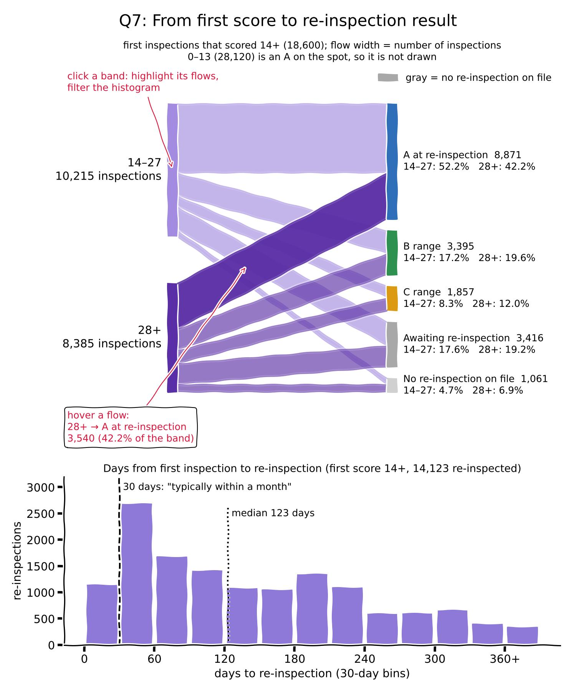

# Do restaurants that miss an A on the first inspection recover at the re-inspection?

A restaurant that scores more than 13 on its first inspection gets a second, unannounced visit, and that visit decides the grade. This page follows restaurants from their first score to the grade they end up with.

```js
const flow = FileAttachment("/data/q7-flow.csv").csv({typed: true});
const days = FileAttachment("/data/q7-days.csv").csv({typed: true});
const pairs = FileAttachment("/data/q7-pairs-sample.csv").csv({typed: true});
const q7 = FileAttachment("/data/q7-summary.json").json();
const format = d3.format(",");
const percentage = d3.format(".1%");
const smallShare = (d) => (d > 0 && d < 0.001 ? "<0.1%" : percentage(d));
const wrap = (text) => html`<div style="white-space: normal">${text}</div>`; // long text wraps instead of being cut off
```

Of the ${format(q7.n_missed_a)} first inspections that scored 14 or more, ${format(q7.n_a_at_reinspection)} (${percentage(q7.share_a_at_reinspection)}) scored in the A range at the re-inspection, and ${format(q7.n_awaiting)} (${percentage(q7.share_awaiting)}) are still waiting for one. Of those already re-inspected, ${percentage(q7.share_recovered_of_reinspected)} recovered. The median wait for a re-inspection was ${q7.median_days_to_reinspection} days, and ${percentage(q7.share_reinspected_under_30_days)} of re-inspections came in under 30 days, although the city's guide says an inspector returns "typically within a month" ([How We Score and Grade](https://www.nyc.gov/assets/doh/downloads/pdf/rii/how-we-score-grade.pdf)).

## Data and transformation

- **Unit of observation:** one first inspection (`Cycle Inspection / Initial Inspection`), paired with the same restaurant's next `Cycle Inspection / Re-inspection`, if that comes before the restaurant's next first inspection.
- **Measures:** first-inspection score band (0–13, 14–27, 28+), re-inspection score band, the grade card after the re-inspection (A, B, C or Grade Pending), and days to the re-inspection.
- **Transformation:** `scripts/question-specific/question-7.py` reads `data/interim/inspections.csv` from `clean.py`, pairs each first inspection with its re-inspection, labels the outcome, counts outcomes per score band and puts the waits into 30-day bins.
- **Outcomes:** a score of 0–13 at the first inspection is an A on the spot. Otherwise the outcome is the band of the re-inspection score. A first inspection from the last 365 days with no re-inspection yet is *awaiting re-inspection*, and an older one is *no re-inspection on file*. Both stay in the counts, so missing re-inspections are shown rather than dropped.
- **Comparison:** how the 14–27 and 28+ bands split across outcomes, and how long each band waits.

## What the data can and cannot show (M1 feedback, point 3)

- The file keeps only restaurants that are open on the record date, with about three years of inspections. Restaurants that missed an A and then closed for good are not in it, so recovery may look better than it was.
- Re-inspections often come months after the first visit, so a first inspection from the last 12 months without one counts as awaiting, not as missing.
- A restaurant that scores 14 or more at the re-inspection gets a grade card and a Grade Pending card, and can post either until its hearing. We group by the re-inspection score, so these restaurants fall in the B or C range, and the card column shows Grade Pending.
- Violations dismissed at a hearing are removed from the file, so an inspection can list fewer violations than the inspector cited.
- The page describes how often restaurants recover. The data do not show why.

## Changes from the proposal

- The proposal planned a flow from first score to final grade. The flow now starts at the two bands that miss an A (0–13 is an A on the spot, so it is only noted) and ends at the re-inspection score band, because a restaurant can post Grade Pending instead of its grade.
- We added two groups for missing re-inspections (awaiting, none on file) and a histogram of waiting times, since re-inspections often come months later.

## Processed data

Outcome of each first inspection, by first-inspection score band:

```js
Inputs.table(flow, {
  columns: ["first_band", "outcome", "count", "share_of_band"],
  header: {first_band: "First-inspection score", outcome: "Outcome", count: "Inspections", share_of_band: "Share of band"},
  format: {count: format, share_of_band: smallShare},
  layout: "auto",
  rows: 16,
  select: false
})
```

Days from the first inspection to the re-inspection, in 30-day bins, for first inspections that scored 14 or more:

```js
Inputs.table(days, {
  columns: ["days", "count_14_27", "count_28_plus", "count", "share"],
  header: {days: "Days", count_14_27: "First 14–27", count_28_plus: "First 28+", count: "Total", share: "Share"},
  format: {count_14_27: format, count_28_plus: format, count: format, share: percentage},
  rows: 14,
  select: false
})
```

Another ${format(q7.n_reinspected_after_a)} re-inspections followed a first score of 0–13. They are left out of this table and of the median wait.

Matched pairs, two per outcome:

```js
Inputs.table(pairs, {
  columns: ["camis", "first_date", "first_score", "reinspection_date", "reinspection_score", "grade_after_reinspection", "days_to_reinspection", "outcome"],
  header: {camis: "CAMIS", first_date: "First insp.", first_score: "Score", reinspection_date: "Re-insp.", reinspection_score: "Score", grade_after_reinspection: "Card", days_to_reinspection: "Days", outcome: "Outcome"},
  format: {camis: String, grade_after_reinspection: wrap, outcome: wrap},
  layout: "auto",
  rows: 30,
  select: false
})
```

## Sketch



Made with Matplotlib from the processed data tables above.

- **Chart:** a flow from the two first-inspection bands that miss an A (14–27, 28+) on the left to the re-inspection outcomes on the right. Flow width is the number of inspections. Awaiting and none on file are gray nodes, so missing re-inspections stay visible. First inspections at 0–13 are an A on the spot, so the sketch notes their count instead of drawing them.
- **Below it:** a histogram of days to re-inspection in 30-day bins, with a line at 30 days for the guide's "typically within a month" and one at the median.
- **Labels:** each node shows its count, and each outcome shows the share of each band that ends there.
- **Interaction (one of our centerpieces):** hovering a flow shows its count and share of the band. Clicking a band highlights its flows and filters the histogram to that band.
