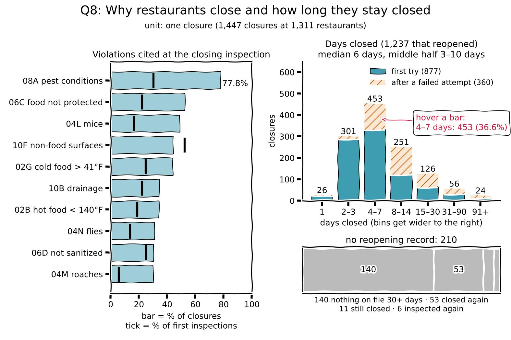

# Which restaurants get closed, and how long does it take them to reopen?

Inspectors can close a restaurant on the spot for a public health hazard. This page looks at why restaurants are closed, how many days they stay closed, and how often they fail their first reopening inspection.

```js
const matching = FileAttachment("/data/q8-matching.csv").csv({typed: true});
const jan = FileAttachment("/data/q8-jan2025.csv").csv({typed: true});
const violations = FileAttachment("/data/q8-violations.csv").csv({typed: true});
const daysClosed = FileAttachment("/data/q8-days-closed.csv").csv({typed: true});
const q8 = FileAttachment("/data/q8-summary.json").json();
const format = d3.format(",");
const percentage = d3.format(".1%");
const share = (d) => (d == null ? "" : percentage(d));
const wrap = (text) => html`<div style="white-space: normal">${text}</div>`; // long text wraps instead of being cut off
```

Of ${format(q8.n_closures)} closures at ${format(q8.n_restaurants)} restaurants, ${format(q8.n_reopened)} (${percentage(q8.share_reopened)}) end in a recorded reopening, after a median of ${q8.median_days_closed} days (middle half: ${q8.p25_days_closed} to ${q8.p75_days_closed} days). ${percentage(q8.share_with_failed_reopening)} of closures include at least one failed reopening attempt. The violation cited most at closures is ${q8.top_code} ("${q8.top_code_description}"), cited at ${percentage(q8.top_code_share)} of closures and ${share(q8.top_code_first_share)} of first inspections.

## Can closures be matched to reopenings? (M1 feedback, point 2)

We first checked a small sample, the ${format(q8.n_jan_sample)} closures that began January 1–10, 2025: ${format(q8.n_jan_sample_reopened)} of them end in a recorded reopening. "Failed" counts failed reopening attempts before the reopening.

```js
Inputs.table(jan, {
  columns: ["camis", "dba", "closed_on", "failed_reopenings", "reopened_on", "days_closed", "status"],
  header: {camis: "CAMIS", dba: "Name", closed_on: "Closed", failed_reopenings: "Failed", reopened_on: "Reopened", days_closed: "Days", status: "How it ends"},
  format: {camis: String, dba: wrap, status: wrap},
  layout: "auto",
  rows: 40,
  select: false
})
```

Across the whole file, ${percentage(q8.share_reopened)} of closures end in a recorded reopening, so Q8 stays as proposed. Closures without a reopening record stay in the data as their own groups. Another ${format(q8.reopened_without_closure)} reopenings and ${format(q8.reclosed_without_closure)} re-closures have no closure on file. The file keeps about three years of inspections, so a closure can fall before that window while its reopening falls inside it. We leave these records out.

```js
Inputs.table(matching, {
  columns: ["status", "closures", "restaurants", "share"],
  header: {status: "How the closure ends", closures: "Closures", restaurants: "Restaurants", share: "Share"},
  format: {status: wrap, closures: format, restaurants: format, share: percentage},
  layout: "auto",
  select: false
})
```

## Data and transformation

- **Unit of observation:** one closure, from the inspection that closed the restaurant to the record that reopened it.
- **Measures:** closure date and inspection type, violations cited at the closing inspection, failed reopening attempts, days closed, and how the closure ends.
- **Transformation:** `scripts/question-specific/question-8.py` reads the three tables from `clean.py` and walks through each closed restaurant's inspections in date order. A closure starts at an inspection whose action begins "Establishment Closed" and ends at the next "Establishment re-opened" record. "Re-closed" records in between, and reopening inspections that close the restaurant again, count as failed attempts. The script then counts the violations cited at each closing inspection.
- **Missing data:** a closure with no reopening record is labeled by what comes after it (closed again, inspected again, still closed in the last 30 days, or nothing on file) instead of being dropped.
- **Comparison:** how often each violation is cited at closures against at first inspections, the spread of days closed, and closures that reopened on the first try against those that failed first.

## What the data can and cannot show (M1 feedback, point 3)

- The file keeps only restaurants that are open on the record date. A closure that ended the business is not in it, so Q8 describes closures at restaurants that are still open, and the reopening share here is not the share for all closures.
- The file keeps about three years of inspections per restaurant, which cuts off older closures.
- Violations are counted as cited at the closing inspection. The file does not say which one led to the closure.

## Changes from the proposal

- No change in scope: the matching check supports Q8 as proposed. We added the groups for closures without a reopening record.

## Processed data

The 15 violations cited most at the inspection that closed the restaurant. "Closures" is how many closing inspections cite the violation, and the last two columns give that as a share of all closures and, for comparison, the share of first inspections that cite it:

```js
Inputs.table(violations, {
  columns: ["violation_code", "violation_description", "critical_flag", "closures_citing", "share_of_closures", "share_of_first_inspections"],
  header: {violation_code: "Code", violation_description: "Violation", critical_flag: "Critical", closures_citing: "Closures", share_of_closures: "% closures", share_of_first_inspections: "% first insp."},
  format: {violation_description: wrap, critical_flag: (d) => (d === "Critical" ? "Yes" : "No"), closures_citing: format, share_of_closures: percentage, share_of_first_inspections: share},
  layout: "auto",
  rows: 70,
  select: false
})
```

Days closed, for closures that reopened, split by whether a reopening attempt failed first:

```js
Inputs.table(daysClosed, {
  columns: ["days_closed", "reopened_first_try", "reopened_after_failed_try", "count"],
  header: {days_closed: "Days closed", reopened_first_try: "First try", reopened_after_failed_try: "After a failed try", count: "All"},
  format: {reopened_first_try: format, reopened_after_failed_try: format, count: format},
  select: false
})
```

## Sketch



Made with Matplotlib from the processed data tables above.

- **Chart:** on the left, bars for the share of closures citing each of the 10 most common violations, with a tick for how often the same violation is cited at first inspections (same 0–100% scale). On the right, bars for days closed in bins (1, 2–3, 4–7, 8–14, 15–30, 31–90, 91+ days), split into closures that reopened on the first try (solid) and after a failed attempt (hatched). Closures with no reopening record are a separate bar below, split by what is on file instead.
- **Labels:** "days closed", the count on each bar, and the median (6 days) and middle half (3–10 days).
- **Interaction:** hovering a bar shows its count and its share of reopened closures.
